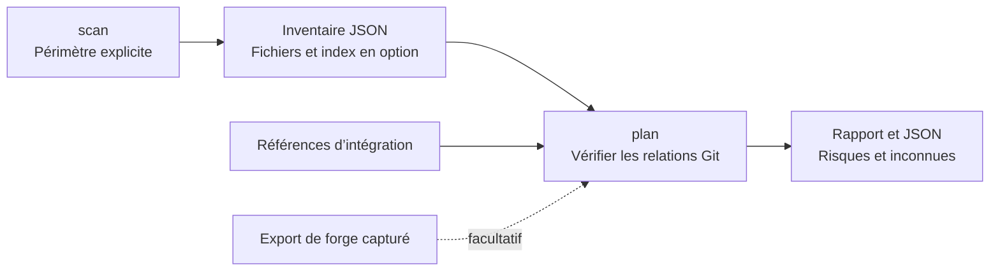
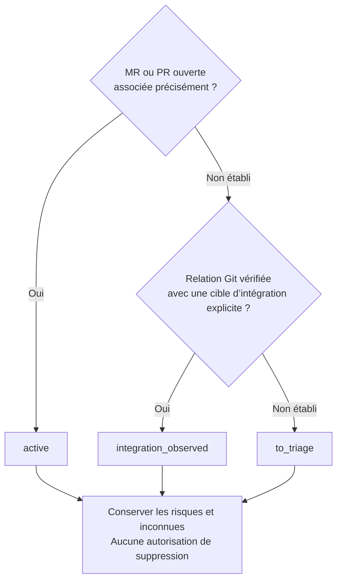

# Worktree Sweep

[English](README.md) · **Français**

<table>
  <tr>
    <td width="64">
      <a href="https://www.florian.bruniaux.com/about/?utm_source=github&amp;utm_medium=readme&amp;utm_campaign=wt-sweep"></a>
    </td>
    <td>
      <strong><a href="https://www.florian.bruniaux.com/about/?utm_source=github&amp;utm_medium=readme&amp;utm_campaign=wt-sweep">Florian BRUNIAUX</a></strong> &middot; AI Founding Engineer @ <a href="https://methode-aristote.fr/">Méthode Aristote</a><br />
      13 ans de parcours, de développeur à CTO / VP Eng &middot; <a href="https://www.florian.bruniaux.com/blog/?utm_source=github&amp;utm_medium=readme&amp;utm_campaign=wt-sweep">Blog &#8599;</a> &middot; <a href="https://www.florian.bruniaux.com/projects/?utm_source=github&amp;utm_medium=readme&amp;utm_campaign=wt-sweep">Projets &#8599;</a>
    </td>
  </tr>
</table>

**Un outil en ligne de commande pour macOS qui inventorie les worktrees Git et compare leurs commits aux références que vous choisissez.**

[](https://github.com/FlorianBruniaux/wt-sweep/actions/workflows/ci.yml)
[](rust-toolchain.toml)
[](docs/getting-started.md#prerequisites)
[](LICENSE.md)

[Démarrage rapide](#démarrage-rapide) · [Fonctionnalités](#fonctionnalités) · [Fonctionnement](#fonctionnement) · [Documentation](#documentation) · [Changelog](CHANGELOG.md) · [Contribuer](CONTRIBUTING.md)

Worktree Sweep (`wt-sweep`) repère les dépôts et leurs worktrees dans le périmètre
que vous choisissez. Il vérifie les relations Git locales et peut inclure dans
ses rapports des inventaires de fichiers et des données capturées depuis GitHub
ou GitLab. Écrit en Rust, il produit du texte et du JSON versionné. Il fonctionne
localement, sans service, compte de forge ni modèle d’IA.

**État : MVP en lecture seule pour macOS.** La découverte et la revue sont
implémentées ; la sauvegarde, la restauration et la suppression sont
indisponibles. `apply` refuse toute invocation. Le nom du projet est provisoire
et aucune version n’a été publiée.


Reproduisez ce cas avec la [démo sur un dépôt jetable](docs/getting-started.md#disposable-demo).
Les [sources du visuel et les notes de revue](docs/assets/README.md) comprennent
le SVG modifiable. L’illustration est en anglais.

## Pourquoi cet outil

Le développement en parallèle laisse des worktrees dispersés entre plusieurs
clones, dossiers cachés et emplacements temporaires. Une branche peut sembler
intégrée alors que son worktree contient encore des notes non suivies, des
fichiers ignorés ou une version différente dans l’index.

Le rapport liste le HEAD complet de chaque worktree, ses relations avec les
références choisies, les PR ou MR associées, ainsi que les risques et les éléments
de preuve manquants. Avec `scan --local`, il relève aussi les fichiers locaux et
l’état de l’index. Ces relevés aident à examiner ce qui reste dans un worktree ;
ils ne contiennent aucune sauvegarde des fichiers.

## Démarrage rapide

### Compiler depuis les sources

Sur macOS, avec Rust installé, clonez le dépôt puis compilez l’outil.
Le dépôt est actuellement privé : il faut y avoir accès sur GitHub pour le cloner.

```sh
git clone https://github.com/FlorianBruniaux/wt-sweep.git
cd wt-sweep
cargo fetch --locked
cargo build --release --locked --offline
./target/release/wt-sweep --help
```

<details>
<summary>Prérequis de compilation et dépendances hors ligne</summary>

Si vous disposez déjà d’une copie du dépôt, lancez les commandes de compilation
depuis sa racine. La version Rust 1.95.0 est fixée dans
[rust-toolchain.toml](rust-toolchain.toml). Le téléchargement des dépendances
nécessite un accès réseau ; passez cette étape si elles sont déjà en cache.
L’outil utilise `/usr/bin/git` pour lire les données Git. Aucune installation via
un gestionnaire de paquets ni configuration globale n’est nécessaire.
Consultez le [guide de démarrage et de dépannage](docs/getting-started.md).

</details>

### Examiner un dépôt et ses worktrees

Définissez `repo_path` avec le chemin du clone à examiner. Le dossier des
rapports doit se trouver hors du dépôt inspecté, de ses worktrees et de ses
répertoires d’administration Git.

```sh
repo_path="/absolute/path/to/your/clone"
report_dir="$(mktemp -d /private/tmp/wt-sweep-report.XXXXXX)"

./target/release/wt-sweep scan --repo "$repo_path" --local \
  --out "$report_dir/inventory.json"

# Choisissez une référence complète existante, par exemple refs/heads/master.
./target/release/wt-sweep plan --inventory "$report_dir/inventory.json" \
  --target refs/heads/main --summary --run-dir "$report_dir"
```

`scan --local` relève les fichiers suivis, non suivis et ignorés présents
localement, dans des limites explicites. `plan` affiche un résumé de cinq lignes
et enregistre le rapport complet, le JSON et un reçu de publication dans un
nouveau dossier d’exécution. Les fichiers de sortie existants ne sont jamais
remplacés. Pour un exemple prêt à exécuter, utilisez la
[démo sur un dépôt jetable](docs/getting-started.md#disposable-demo).

### Lire le résultat

La [démo](docs/getting-started.md#disposable-demo) produit l’extrait de résumé
ci-dessous. Le HEAD de chacun des deux worktrees correspond à la cible choisie :

```text
Worktrees: 2
Active: 0; integration observed: 2; to triage: 0
Unknowns: 2 worktrees; coverage gaps: 0
```

Le rapport complet indique chaque worktree, sa branche, son HEAD et la relation
observée. Consultez le [rapport capturé](docs/getting-started.md#read-a-review)
et l’[extrait JSON annoté](docs/contracts.md#example-review-item).

| Classification | Ce qui a été observé |
| --- | --- |
| `active` | Une MR ou PR ouverte a été associée au worktree par son hôte de forge, son projet, sa branche et son HEAD. Cette observation prime sur les observations d’intégration. |
| `integration_observed` | Une relation vérifiée entre commits ou arbres Git relie le worktree à une référence explicitement choisie avec `--target`. |
| `to_triage` | Aucune des deux conditions n’a été établie. Examinez les observations et les inconnues. |

**Aucune de ces classifications n’autorise une suppression.** Un worktree dont
le HEAD est intégré peut encore contenir des modifications locales. L’absence
de preuve issue d’une forge reste une inconnue, même lorsqu’une intégration Git
a été observée.

## Fonctionnalités

<details>
<summary>Capacités et commandes correspondantes</summary>

| Fonctionnalité | Utilité | Commande ou option |
| --- | --- | --- |
| Familles de dépôts | Repérer le worktree principal, les worktrees liés et ceux à HEAD détaché, ainsi que les worktrees enregistrés mais absents. | `scan --repo PATH` |
| Découverte ciblée | Parcourir les racines choisies, y compris les dossiers cachés, ignorés et imbriqués, en conservant les lacunes de couverture. | `scan --root PATH` |
| Inventaires de fichiers locaux | Examiner les empreintes, métadonnées, entrées d’index et certains éléments d’administration du worktree. | `scan --local` |
| Relations Git | Vérifier l’identité de commits, l’ascendance et l’identité d’arbres par rapport aux références nommées. | `plan --target FULL_REF` |
| Preuves de forge hors ligne | Importer des données capturées depuis GitHub ou GitLab avec leur provenance, sans contacter de forge. | `forge ingerer` |
| Rapports texte et JSON | Lire le rapport détaillé ou le résumé de cinq lignes ; conserver les octets complets des chemins et les identifiants d’objets Git dans le JSON. | `--summary`, `--format json` |
| Exécutions séparées | Conserver les rapports concurrents dans des dossiers distincts, avec les empreintes des fichiers produits et les horodatages de publication. | `--run-dir BASE` |

La découverte globale est également disponible via `scan --all`. Elle utilise
les volumes montés visibles et signale les lacunes d’accès. Elle a été testée
avec des volumes injectés, sans scanner la machine de développement.
Commencez par un dépôt ou des racines choisies.

</details>

## Fonctionnement

`scan` enregistre un inventaire dans le périmètre choisi. `plan` le lit, vérifie
les relations Git avec les cibles explicites et produit une revue :



`plan` reprend les inventaires de fichiers locaux sauvegardés sans relire leur
contenu. Une relation Git observée ne dit donc rien des changements apportés
aux fichiers locaux depuis le scan.

<details>
<summary>Règles de classification d’un worktree</summary>

Une MR ou PR ouverte ne prime que si son hôte de forge, son projet, sa branche
source et son HEAD complet correspondent au worktree. Sinon, la revue cherche
une relation vérifiée entre commits ou arbres Git avec une cible d’intégration
explicite.



Le [tableau des classifications](#lire-le-résultat) et les
[contrats de preuve](docs/contracts.md#reviews-and-relationships) expliquent
comment interpréter ces résultats.

</details>

La collecte limite le volume lu et la durée des opérations. Elle vérifie les
octets des objets Git contre leurs identifiants complets (OID). Le code de revue
classe ensuite ces observations sans autre entrée-sortie. L’âge, un patch-id,
une MR fermée ou la suggestion d’un modèle ne permettent pas d’établir
l’intégration.

Sur macOS, le processus désactive la matérialisation des fichiers non résidents
(*dataless*) et vérifie cette politique avant les lectures protégées, y compris
pour ses processus Git enfants. Si cette politique ne peut pas être établie,
l’opération est refusée. Les échecs d’accès et les dépassements de délai restent
visibles. Un parcours terminé reste un ensemble d’observations sur un intervalle
de temps, pas un instantané atomique du système de fichiers.

L’[architecture](docs/architecture.md) et les [contrats de preuve](docs/contracts.md)
précisent les limites de lecture et de publication des rapports.

## Documentation

| Guide | Contenu |
| --- | --- |
| [Démarrage](docs/getting-started.md) | Installation, démo sur un dépôt jetable, lecture des rapports et dépannage |
| [Référence CLI](docs/cli.md) | Commandes, valeurs par défaut, modes de sortie, limites et codes de retour |
| [Imports de forge hors ligne](docs/forge.md) | Exports, reçus d’exécution et limites d’association |
| [Preuves et JSON](docs/contracts.md) | Champs des schémas, octets des chemins, empreintes et reçus d’exécution |
| [Architecture](docs/architecture.md) | Rôle des modules, limites de lecture et stratégie de test |
| [Index documentaire](docs/README.md) | Ensemble des guides, décisions de conception et relevés de validation |

Les guides détaillés sont en anglais. Les documents de conception, d’expérimentation
et d’implémentation sont conservés dans leur version française d’origine.

## Feuille de route et validation

La découverte et la revue sont implémentées. L’exclusion des écritures
concurrentes n’a pas été démontrée ; la sauvegarde, la restauration et la
suppression restent donc indisponibles.

<details>
<summary>Étapes d’implémentation et validations consignées</summary>

| Étape | État actuel |
| --- | --- |
| U1–U4 : découverte et revue | Implémentées et testées localement sur macOS ; les limites des preuves restent explicites. |
| E1 : exclure les écritures concurrentes | **Non démontré.** Les expériences existantes mettent en défaut les approches proposées par verrouillage et renommage. |
| U5 : sauvegarde durable et restauration indépendante | Bloquée par E1 et par l’absence d’un contrat de préservation complet. |
| U6–U7 : suppression | Indisponible, dans l’attente de validations sur des dépôts jetables, d’une revue indépendante et d’une approbation humaine portant sur les actions exactes. |

Le [plan d’acceptation](docs/plan.md) définit les conditions à remplir. La
[décision concernant `apply`](docs/decisions/apply-readiness.md) consigne
pourquoi elles ne sont pas remplies.

Le point de contrôle du 2026-10-05 a enregistré 92 tests Rust et 78 tests Python
réussis. Les tests non exécutés, les résultats des expériences natives et
l’empreinte du binaire testé figurent dans le
[registre de validation](docs/finish-ledger.md#vérifications). Le badge CI
renvoie aux résultats du workflow distant, distincts de ces contrôles locaux.
Les fichiers non résidents réels de FileProvider, les refus TCC réels et un
instantané de toute la machine n’ont pas été vérifiés.

</details>

## Développement et état du projet

Consultez [CONTRIBUTING.md](CONTRIBUTING.md) pour la compilation, les commandes
de test, les dépôts jetables et les conventions documentaires. Le
[changelog](CHANGELOG.md) suit les changements non publiés ; les
[outils apparentés](docs/references.md) restent des candidats à une comparaison
de comportement avant de construire un moteur de suppression.

Le projet se distribue actuellement par ses sources. La publication Cargo est
désactivée ; aucun paquet n’a été publié.

## Licence

[Functional Source License 1.1, avec future licence Apache 2.0](LICENSE.md)
(`FSL-1.1-ALv2`), copyright 2026 Florian Bruniaux. Agent Router utilise la même
licence.

La FSL restreint les usages commerciaux concurrents. Chaque version bénéficie
d’une licence Apache 2.0 supplémentaire deux ans après sa mise à disposition.
Consultez les [conditions complètes](LICENSE.md) et
l’[explication de la FSL](https://fsl.software/). Les dépendances tierces
conservent leurs propres licences.
