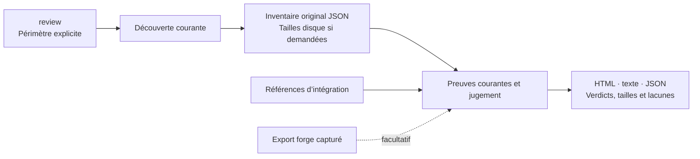
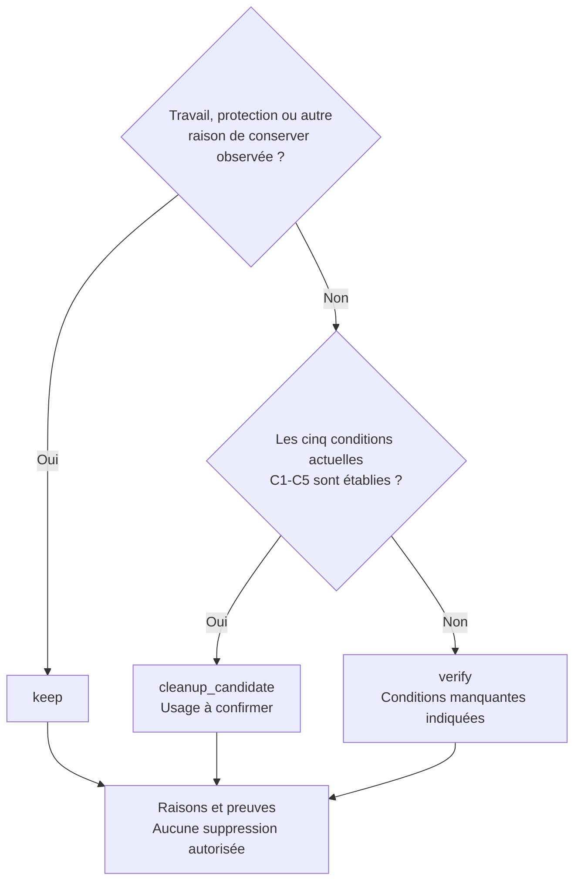

# Worktree Sweep

[English](README.md) · **Français**

**Disque plein : identifiez les worktrees à examiner et le travail à conserver.**

<table>
  <tr>
    <td width="64">
      <a href="https://www.florian.bruniaux.com/about/?utm_source=github&amp;utm_medium=readme&amp;utm_campaign=wt-sweep"></a>
    </td>
    <td>
      <strong><a href="https://www.florian.bruniaux.com/about/?utm_source=github&amp;utm_medium=readme&amp;utm_campaign=wt-sweep">Florian BRUNIAUX</a></strong> &middot; AI Founding Engineer @ <a href="https://methode-aristote.fr/">Méthode Aristote</a><br />
      13 ans de parcours, de développeur à CTO / VP Eng &middot; <a href="https://www.florian.bruniaux.com/blog/?utm_source=github&amp;utm_medium=readme&amp;utm_campaign=wt-sweep">Blog &#8599;</a> &middot; <a href="https://www.florian.bruniaux.com/projects/?utm_source=github&amp;utm_medium=readme&amp;utm_campaign=wt-sweep">Projets &#8599;</a>
    </td>
  </tr>
</table>

---

[](https://github.com/FlorianBruniaux/wt-sweep/actions/workflows/ci.yml)
[](rust-toolchain.toml)
[](docs/getting-started.md#prerequisites)
[](LICENSE.md)

[Démarrage rapide](#démarrage-rapide) · [Rapport HTML](#rapport-html) · [Fonctionnalités](#fonctionnalités) · [Fonctionnement](#fonctionnement) · [Documentation](#documentation)

[Tutoriel et tests](docs/tutorial.fr.md) · [Prompt à copier](docs/tutorial.fr.md#prompt-à-donner-à-un-assistant) · [Feuille de route](docs/roadmap.md) · [Changelog](CHANGELOG.md) · [Contribuer](CONTRIBUTING.md)

---

## Pourquoi cet outil

J’ai créé Worktree Sweep parce que je n’avais plus de place sur mon disque.
Avant de faire le ménage, je voulais retrouver mes worktrees Git, mesurer leur
taille et savoir lesquels contenaient encore du travail à garder.

Les worktrees peuvent se retrouver dans les dossiers des projets et ceux des
agents de code. Une branche fusionnée peut encore contenir des modifications
non commitées, des fichiers ignorés ou des notes locales. Les vérifier dossier
par dossier oblige à répéter les commandes Git et à recouper leurs résultats.

Worktree Sweep (`wt-sweep`) réunit ce bilan dans un rapport : chemins, branches,
tailles disque et raisons de conserver un worktree ou de l’examiner davantage.
Il fonctionne localement sur macOS, sans modèle d’IA, service ni compte de forge.

## Partir de votre problème

| Votre problème | Ce que Sweep vous apporte | Par où commencer |
| --- | --- | --- |
| **Plus de place sur le disque** | Les tailles mesurées des worktrees et du stockage Git partagé, avec les mesures absentes ou partielles signalées. Le tri par taille dans le HTML aide à choisir les dossiers à examiner d’abord. | [Analyser avec les tailles disque](#examiner-un-dépôt-et-ses-worktrees) |
| **Des worktrees dispersés dans plusieurs dossiers** | Un inventaire regroupé par famille Git, avec chemins et branches. La découverte couvre les racines choisies et conserve les lacunes d’accès. | [Choisir les dépôts ou racines](docs/cli.md) |
| **Je ne sais pas quels worktrees nettoyer** | Des vérifications d’intégration Git, de modifications locales et d’histoire privée. Le rapport distingue le travail à conserver, les contrôles manquants et les candidats au nettoyage. | [Lire les verdicts](#lire-le-résultat) |

La taille aide à choisir par où commencer ; elle ne prouve pas qu’un worktree
peut être supprimé. Sur APFS, l’espace alloué mesuré n’est pas une estimation du
gain après suppression. Même pour un candidat, il reste à confirmer qu’aucun
agent ou terminal ne l’utilise.

> [!NOTE]
> **MVP en lecture seule pour macOS.** Sweep prépare le bilan de nettoyage ;
> il ne libère pas lui-même d’espace disque. Sauvegarde, restauration et
> suppression sont indisponibles ; `apply` refuse toute invocation.
> Le nom du projet est provisoire et aucune version n’a été publiée.

---

## Rapport HTML

<picture>
  <source media="(prefers-color-scheme: dark)" srcset="docs/assets/report-dark.png" />
  
</picture>

Capture du vrai rapport de la CLI sur un dépôt jetable, avec le thème BoldGuy
de ce checkout. La démo compte quatre worktrees : trois à conserver et un
candidat dont l’usage reste à confirmer. Ces résultats sont synthétiques ;
ils ne proviennent pas d’un scan de votre machine.
[Provenance des captures et anciennes illustrations](docs/assets/README.md).

Le rapport regroupe les worktrees par famille Git. Recherche, filtres de verdict,
tri par taille et preuves repliables permettent de cibler la revue. Le thème
clair/sombre, les tailles en Ko/Mo/Go et les boutons **Copy path** sont disponibles
dans ce checkout ; leur livraison est suivie dans
[#16](https://github.com/FlorianBruniaux/wt-sweep/issues/16).
Le rapport et ses preuves repliables fonctionnent hors ligne et sans JavaScript.
La recherche, le tri et la copie demandent JavaScript. Le rapport est en anglais.

<details>
<summary>Voir les lignes, tailles disque et boutons de copie</summary>

<picture>
  <source media="(prefers-color-scheme: dark)" srcset="docs/assets/report-details-dark.png" />
  
</picture>

</details>

---

## Démarrage rapide

### Compiler depuis les sources

Sur macOS, avec Rust installé, clonez le dépôt puis compilez l’outil.
Le dépôt est actuellement privé : il faut y avoir accès sur GitHub pour le cloner.

```sh
git clone https://github.com/FlorianBruniaux/wt-sweep.git
cd wt-sweep
cargo fetch --locked
cargo build --release --locked --offline
./target/release/wt-sweep --help
```

<details>
<summary>Prérequis de compilation et dépendances hors ligne</summary>

Si vous disposez déjà d’une copie du dépôt, lancez les commandes de compilation
depuis sa racine. La version Rust 1.95.0 est fixée dans
[rust-toolchain.toml](rust-toolchain.toml). Le téléchargement des dépendances
nécessite un accès réseau ; passez cette étape si elles sont déjà en cache.
L’outil utilise `/usr/bin/git` pour lire les données Git. Aucune installation via
un gestionnaire de paquets ni configuration globale n’est nécessaire.
Consultez le [guide de démarrage et de dépannage](docs/getting-started.md).

</details>

### Examiner un dépôt et ses worktrees

Depuis la racine de `wt-sweep`, après compilation, saisissez le chemin du clone
et la référence d’intégration que vous avez confirmée. Le bloc s’arrête si cette
référence manque localement.

```sh
(
  set -eu
  sweep_bin="$PWD/target/release/wt-sweep"
  printf 'Chemin absolu du clone : '
  IFS= read -r repo_path
  printf 'Référence complète confirmée (refs/heads/... ou refs/remotes/...) : '
  IFS= read -r target_ref
  /usr/bin/git --no-optional-locks -c core.fsmonitor=false -C "$repo_path" \
    show-ref --verify --quiet "$target_ref"
  report_dir="$(mktemp -d /private/tmp/wt-sweep-report.XXXXXX)"
  "$sweep_bin" review --repo "$repo_path" --target "$target_ref" \
    --summary --disk-usage --html --run-dir "$report_dir"
  printf 'Rapports : %s\n' "$report_dir"
  open "$report_dir"/run-*/report.html
)
```

Gardez `XXXXXX` tel quel : `mktemp` le remplace par un suffixe unique. Le dossier
des rapports doit se trouver hors du dépôt, de ses worktrees enregistrés et de
ses administrations Git. `review` découvre la famille puis collecte les preuves
courantes. Son nouveau dossier contient l’inventaire original `inventory.json`,
la revue `review.json`, le détail `report.txt`, le bilan hors ligne `report.html`
et le reçu `run.json`. Le HTML regroupe les worktrees par famille Git, avec
recherche, tri et preuves repliables. Les totaux source, sélectionnés et visibles
restent distincts. Un bouton copie le chemin de chaque ligne ; si le navigateur
refuse le presse-papiers, un champ sélectionné permet la copie manuelle. Consultez
le [guide du rapport HTML](docs/html-report-plan.md).

Pour les empreintes détaillées des fichiers ou une revue séparée de l’inventaire,
suivez le [parcours avancé scan puis plan](docs/tutorial.fr.md#parcours-avancé-scan-puis-plan).
Un manifeste enregistre des observations, pas le contenu des fichiers.

### Lire le résultat

Chaque ligne indique le worktree, sa branche, son HEAD complet, son état local,
son histoire et son verdict. `--summary` affiche un bilan court : verdicts,
espace disque et contrôles manquants. Les couleurs et icônes sont automatiques
dans le terminal ; la progression tient sur une ligne. Ajoutez `--verbose` pour
les logs et durées détaillés, ou `--color never` pour une sortie sobre.
`report.txt` conserve les raisons, chemins et preuves. Le JSON et les fichiers
enregistrés restent sans codes de couleur.

| Verdict | Signification |
| --- | --- |
| `keep` | Travail à préserver, checkout principal, protection, opération ou autre raison positive de conserver. |
| `cleanup_candidate` | Les contrôles actuels, l’intégration Git, l’état local propre et la conservation de l’histoire satisfont les cinq conditions. |
| `verify` | Des preuves nécessaires manquent ou se contredisent. Le rapport indique les conditions à vérifier. |

L’usage d’un candidat reste à confirmer avant tout retrait. Le rapport n’autorise
aucune suppression et ne constitue pas une sauvegarde complète. Un HEAD mergé ne
suffit pas s’il reste des modifications locales ou une histoire propre au reflog.
Consultez le [contrat de décision](docs/contracts.md#triage-policy) et le
[tutoriel](docs/tutorial.fr.md).

---

## Utiliser avec Claude ou Codex

Le dépôt inclut le skill `wt-sweep` pour lire les rapports par petits groupes et
proposer les actions de conservation ou de vérification utiles. Ouvrez Claude
Code ou Codex dans ce checkout, invoquez `/wt-sweep` ou `$wt-sweep`, puis donnez
le chemin du dépôt et la référence d’intégration confirmée. Le skill conserve
les verdicts de la CLI et leurs limites. La suppression reste indisponible. Le guide décrit aussi le choix du modèle,
du raisonnement et le recours limité à des sous-agents.

Le [guide de l’assistant et ses prompts](docs/assistant-skill.md) couvre une
nouvelle revue, la reprise d’un rapport et un test local sur des dépôts jetables.

Commencez avec le profil `standard`, puis inspectez les faits sauvegardés. Pour
une ligne arrêtée par ces plafonds, la [collecte ciblée](docs/tutorial.fr.md#approfondir-un-worktree-après-une-analyse-partielle)
combine `--worktree` et `--budget thorough`. Lisez ce nouveau résultat avant une
revue thorough de toute la famille. Les autres lignes et leurs preuves manquantes
restent visibles. Ces plafonds plus grands incluent les fichiers ignorés ; ils ne
garantissent pas une collecte complète.

---

## Fonctionnalités

<details>
<summary>Capacités et commandes correspondantes</summary>

| Fonctionnalité | Utilité | Commande ou option |
| --- | --- | --- |
| Familles de dépôts | Repérer le worktree principal, les worktrees liés et ceux à HEAD détaché, ainsi que les worktrees enregistrés mais absents. | `scan --repo PATH` |
| Découverte ciblée | Parcourir les racines choisies, y compris les dossiers cachés, ignorés et imbriqués, en conservant les lacunes de couverture. | `scan --root PATH` |
| Revue en une commande | Découvrir le périmètre et collecter les preuves courantes du triage. | `review --repo PATH` |
| État local courant | Comparer HEAD, index et fichiers avec compteurs complets ou partiels. | `review` ou `plan` |
| Inventaires de fichiers locaux | Examiner les empreintes, métadonnées, entrées d’index et certains éléments d’administration du worktree. | `scan --local` |
| Relations Git | Vérifier l’identité de commits, l’ascendance et l’identité d’arbres par rapport aux références nommées. | `plan --target FULL_REF` |
| Preuves de forge hors ligne | Importer des données capturées depuis GitHub ou GitLab avec leur provenance, sans contacter de forge. | `forge ingerer` |
| Rapports texte et JSON | Lire le rapport détaillé ou le bilan structuré dans la console ; conserver les octets complets des chemins et les identifiants d’objets Git dans le JSON. | `--summary`, `--format json` |
| Espace disque | Mesurer les tailles logiques et allouées, fichiers ignorés inclus, avec résultats partiels et déduplication par inode. | `--disk-usage` |
| HTML hors ligne | Parcourir les worktrees par famille, chercher, trier et consulter les preuves capturées. | `--html --run-dir BASE` |
| Collecte ciblée | Consacrer le budget par worktree à un chemin choisi après lecture de ses lacunes. | `--worktree PATH --budget thorough` |
| Exécutions séparées | Conserver les rapports concurrents dans des dossiers distincts, avec les empreintes des fichiers produits et les horodatages de publication. | `--run-dir BASE` |

La découverte globale est également disponible via `scan --all` ou `review --all`. Elle utilise
les volumes montés visibles et signale les lacunes d’accès. Elle a été testée
avec des volumes injectés, sans scanner la machine de développement.
Commencez par un dépôt ou des racines choisies.

</details>

---

## Fonctionnement

`review` combine découverte et revue. Les commandes séparées `scan` et `plan`
restent disponibles pour les manifestes détaillés et les inventaires sauvegardés.
La cible d’intégration est explicite ; aucune branche par défaut n’est devinée.



La revue sépare les relations du graphe de la vérification approfondie des objets.
Le détail distingue index, fichiers, conflits, contenu non suivi et ignoré,
histoire privée et stashes partagés. Les compteurs partiels restent des bornes
minimales ou `UNKNOWN`. Les sujets de commit et changelogs donnent du contexte ;
ils ne prouvent pas l’intégration.

<details>
<summary>Règles de classification d’un worktree</summary>

Les raisons de conserver sont prioritaires. Seul un worktree lié avec des
contrôles actuels complets, une intégration vérifiée, un état local propre et une
histoire couverte peut devenir candidat. L’absence d’export de forge ne suffit
pas à invalider ces preuves.



Le [tableau des classifications](#lire-le-résultat) et les
[contrats de preuve](docs/contracts.md#reviews-and-relationships) expliquent
comment interpréter ces résultats.

</details>

La collecte limite le volume lu et la durée des opérations. Elle vérifie les
octets des objets Git contre leurs identifiants complets (OID). Le code de revue
classe ensuite ces observations sans autre entrée-sortie. L’âge, un patch-id,
une MR fermée ou la suggestion d’un modèle ne permettent pas d’établir
l’intégration.

Sur macOS, le processus désactive la matérialisation des fichiers non résidents
(*dataless*) et vérifie cette politique avant les lectures protégées, y compris
pour ses processus Git enfants. Si cette politique ne peut pas être établie,
l’opération est refusée. Les échecs d’accès et les dépassements de délai restent
visibles. Un parcours terminé reste un ensemble d’observations sur un intervalle
de temps, pas un instantané atomique du système de fichiers.

L’[architecture](docs/architecture.md) et les [contrats de preuve](docs/contracts.md)
précisent les limites de lecture et de publication des rapports.

---

**Espace disque :** ajouter `--disk-usage` à `scan` ou `review` pour mesurer chaque
worktree et son dossier Git partagé, avec un total dédupliqué. La CLI écrit les
chiffres dans le récapitulatif console, le texte, le JSON et le HTML demandé.
`--disk-root CHEMIN_ABSOLU` limite la mesure aux racines enregistrées choisies ;
les autres restent listées comme non demandées. Le budget restant est réparti
entre les racines encore à visiter. `plan` conserve les mesures capturées.
Les fichiers ignorés sont inclus et les mesures partielles
signalées. Le HTML utilise les unités décimales Ko/Mo/Go et conserve les octets
exacts dans les détails. Les octets alloués n’estiment pas l’espace récupérable
sur APFS. [Mesurer l’espace disque](docs/disk-usage.md).

## Documentation

Les rapports affichent le temps de découverte et le débit d’entrées listées.
Les bilans de revue indiquent la phase de collecte la plus longue. Le
[guide de performance et benchmark Rust](docs/collection-performance.md#benchmark-rust-reproductible)
permet de comparer les workers sur un corpus constant, avec contrôle de couverture.

| Guide | Contenu |
| --- | --- |
| [Tutoriel en français](docs/tutorial.fr.md) | Essai sur un dépôt jetable, tests automatiques, premier dépôt réel et prompt pour un assistant |
| [Démarrage](docs/getting-started.md) | Installation, démo sur un dépôt jetable, lecture des rapports et dépannage |
| [Rapport HTML](docs/html-report-plan.md) | Génération, navigation, thèmes, copie des chemins et preuves enregistrées |
| [Référence CLI](docs/cli.md) | Commandes, valeurs par défaut, modes de sortie, limites et codes de retour |
| [Cibles et filtres](docs/targets-and-filters.md) | Cibles par dépôt, sélection des lignes et rapports regroupés (anglais) |
| [Imports de forge hors ligne](docs/forge.md) | Exports, reçus d’exécution et limites d’association |
| [Preuves et JSON](docs/contracts.md) | Champs des schémas, octets des chemins, empreintes et reçus d’exécution |
| [Architecture](docs/architecture.md) | Rôle des modules, limites de lecture et stratégie de test |
| [Index documentaire](docs/README.md) | Ensemble des guides, décisions de conception et relevés de validation |

Le tutoriel est en français ; les autres guides d’utilisation détaillés sont en
anglais. Les documents de conception, d’expérimentation et d’implémentation sont
conservés dans leur version française d’origine.

---

## Feuille de route et validation

Le jalon d’audit en lecture seule
[#8](https://github.com/FlorianBruniaux/wt-sweep/issues/8) est clos. La
[PR #15](https://github.com/FlorianBruniaux/wt-sweep/pull/15), fusionnée le
08/10/2026 au commit `0c3e1a59e380175991fb2ab7d539d1e87e04f67e`, livre le
HTML, les tailles disque, les faits progressifs, les mesures de collecte et la
comparaison d’outils sur dépôts jetables.

La [recette du contenu intégré](https://github.com/FlorianBruniaux/wt-sweep/issues/13#issuecomment-6052388331)
retrouve les 63 inscriptions connues sur deux racines choisies : 12 `keep`,
51 `verify`, aucun candidat. Les 63 résumés locaux restent partiels, ainsi que
58 des 65 mesures disque. Le parcours des dossiers a aussi atteint sa limite.
Ce relevé borné ne constitue pas un inventaire exhaustif de la machine.

La suite porte sur la livraison des finitions HTML locales
[#16](https://github.com/FlorianBruniaux/wt-sweep/issues/16) et le rétablissement
de la CI [#17](https://github.com/FlorianBruniaux/wt-sweep/issues/17).
GitHub n’a pas démarré le dernier job de main à cause du paiement ou du plafond
de dépense du compte. Les tests locaux ne valent pas succès de CI distante.
Les options de gestion restent dans la
[vision #14](https://github.com/FlorianBruniaux/wt-sweep/issues/14) ;
sauvegarde, restauration et suppression restent indisponibles.

<details>
<summary>Étapes d’implémentation et validations consignées</summary>

| Étape | État actuel |
| --- | --- |
| U1–U4 : découverte et revue | Implémentées et testées localement sur macOS ; les limites des preuves restent explicites. |
| T01-T09 : triage des worktrees | Fusionné ; revue en une commande, verdicts C1-C5, état local, histoire privée, cibles, filtres et rapports. |
| Couverture des gros dépôts | Lectures groupées et passage ciblé disponibles ; l’essai du gros dépôt reste partiel. |
| E1 : exclure les écritures concurrentes | **Non démontré.** Les expériences existantes mettent en défaut les approches proposées par verrouillage et renommage. |
| U5 : sauvegarde durable et restauration indépendante | Bloquée par E1 et par l’absence d’un contrat de préservation complet. |
| U6–U7 : suppression | Indisponible, dans l’attente de validations sur des dépôts jetables, d’une revue indépendante et d’une approbation humaine portant sur les actions exactes. |

Le [plan d’acceptation](docs/plan.md) définit les conditions à remplir. La
[décision concernant `apply`](docs/decisions/apply-readiness.md) consigne
pourquoi elles ne sont pas remplies.

L’arbre source fusionné par #15 a passé localement 365 tests Rust (3 ignorés)
et 292 cas Python (6 ignorés). [#9](https://github.com/FlorianBruniaux/wt-sweep/issues/9)
consigne le commit vérifié et les cas ignorés. Les contrôles de présentation
suivants sont séparés dans le [registre courant](docs/progress.md). Le
[registre historique](docs/finish-ledger.md#triage-t01-t09) conserve les anciens
checkpoints. Le badge CI renvoie aux résultats distants.
Les vrais placeholders FileProvider, refus TCC et instantanés machine restent
non vérifiés.

</details>

---

## Développement et état du projet

Consultez [CONTRIBUTING.md](CONTRIBUTING.md) pour la compilation, les commandes
de test, les dépôts jetables et les conventions documentaires. Le
[changelog](CHANGELOG.md) suit les changements non publiés. La
[comparaison exécutée](docs/research/worktree-runtime-comparison-2026-10-07.md)
couvre 48 audits natifs de Sweep, Holt et AgentRinse sur dépôts jetables ;
elle ne valide ni restauration ni suppression.

Le projet se distribue actuellement par ses sources. La publication Cargo est
désactivée ; aucun paquet n’a été publié.

---

## Licence

[Functional Source License 1.1, avec future licence Apache 2.0](LICENSE.md)
(`FSL-1.1-ALv2`), copyright 2026 Florian Bruniaux. Agent Router utilise la même
licence.

La FSL restreint les usages commerciaux concurrents. Chaque version bénéficie
d’une licence Apache 2.0 supplémentaire deux ans après sa mise à disposition.
Consultez les [conditions complètes](LICENSE.md) et
l’[explication de la FSL](https://fsl.software/). Les dépendances tierces
conservent leurs propres licences.
