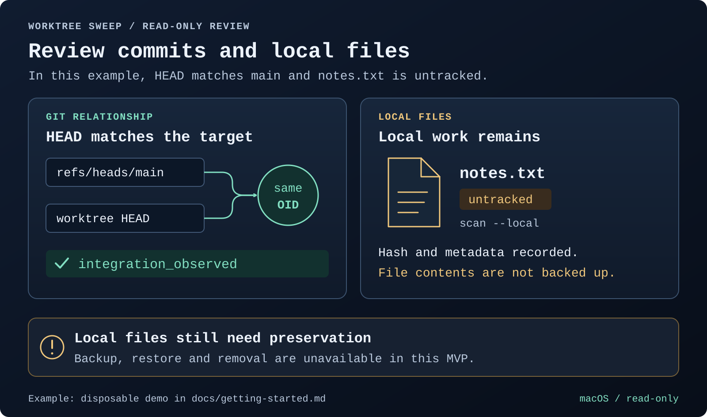
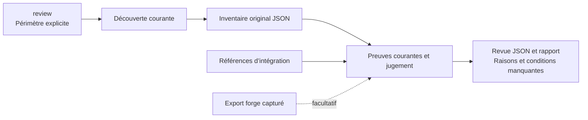
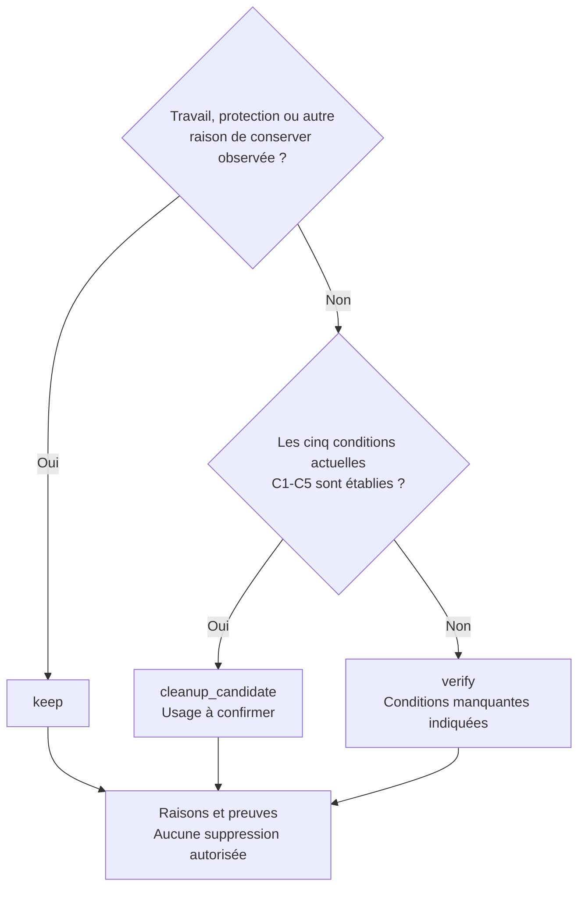

# Worktree Sweep

[English](README.md) · **Français**

<table>
  <tr>
    <td width="64">
      <a href="https://www.florian.bruniaux.com/about/?utm_source=github&amp;utm_medium=readme&amp;utm_campaign=wt-sweep"></a>
    </td>
    <td>
      <strong><a href="https://www.florian.bruniaux.com/about/?utm_source=github&amp;utm_medium=readme&amp;utm_campaign=wt-sweep">Florian BRUNIAUX</a></strong> &middot; AI Founding Engineer @ <a href="https://methode-aristote.fr/">Méthode Aristote</a><br />
      13 ans de parcours, de développeur à CTO / VP Eng &middot; <a href="https://www.florian.bruniaux.com/blog/?utm_source=github&amp;utm_medium=readme&amp;utm_campaign=wt-sweep">Blog &#8599;</a> &middot; <a href="https://www.florian.bruniaux.com/projects/?utm_source=github&amp;utm_medium=readme&amp;utm_campaign=wt-sweep">Projets &#8599;</a>
    </td>
  </tr>
</table>

**Un outil en ligne de commande pour macOS qui inventorie les worktrees Git et compare leurs commits aux références que vous choisissez.**

[](https://github.com/FlorianBruniaux/wt-sweep/actions/workflows/ci.yml)
[](rust-toolchain.toml)
[](docs/getting-started.md#prerequisites)
[](LICENSE.md)

[Démarrage rapide](#démarrage-rapide) · [Tutoriel et tests](docs/tutorial.fr.md) · [Prompt à copier](docs/tutorial.fr.md#prompt-à-donner-à-un-assistant) · [Fonctionnalités](#fonctionnalités) · [Fonctionnement](#fonctionnement) · [Documentation](#documentation) · [Changelog](CHANGELOG.md) · [Contribuer](CONTRIBUTING.md)

Worktree Sweep (`wt-sweep`) repère les dépôts et leurs worktrees dans le périmètre
que vous choisissez. Il vérifie les relations Git locales et peut inclure dans
ses rapports des inventaires de fichiers et des données capturées depuis GitHub
ou GitLab. Écrit en Rust, il produit du texte et du JSON versionné. Il fonctionne
localement, sans service, compte de forge ni modèle d’IA.

**État : MVP en lecture seule pour macOS.** La découverte et la revue sont
implémentées ; la sauvegarde, la restauration et la suppression sont
indisponibles. `apply` refuse toute invocation. Le nom du projet est provisoire
et aucune version n’a été publiée.



Illustration historique des preuves. Avec `triage/1`, le contenu non suivi impose `keep`.

Reproduisez ce cas avec la [démo sur un dépôt jetable](docs/getting-started.md#disposable-demo).
Les [sources du visuel et les notes de revue](docs/assets/README.md) comprennent
le SVG modifiable. L’illustration est en anglais.

## Pourquoi cet outil

Le développement en parallèle laisse des worktrees dispersés entre plusieurs
clones, dossiers cachés et emplacements temporaires. Une branche peut sembler
intégrée alors que son worktree contient encore des notes non suivies, des
fichiers ignorés ou une version différente dans l’index.

Le rapport liste le HEAD complet de chaque worktree, ses relations avec les
références choisies, les PR ou MR associées, ainsi que les risques et les éléments
de preuve manquants. `review` et `plan` comparent le HEAD, l’index et les fichiers
courants. Avec `scan --local`, l’inventaire relève aussi leurs empreintes et
métadonnées détaillées. Ces relevés aident à examiner ce qui reste dans un worktree ;
ils ne contiennent aucune sauvegarde des fichiers.

## Démarrage rapide

### Compiler depuis les sources

Sur macOS, avec Rust installé, clonez le dépôt puis compilez l’outil.
Le dépôt est actuellement privé : il faut y avoir accès sur GitHub pour le cloner.

```sh
git clone https://github.com/FlorianBruniaux/wt-sweep.git
cd wt-sweep
cargo fetch --locked
cargo build --release --locked --offline
./target/release/wt-sweep --help
```

<details>
<summary>Prérequis de compilation et dépendances hors ligne</summary>

Si vous disposez déjà d’une copie du dépôt, lancez les commandes de compilation
depuis sa racine. La version Rust 1.95.0 est fixée dans
[rust-toolchain.toml](rust-toolchain.toml). Le téléchargement des dépendances
nécessite un accès réseau ; passez cette étape si elles sont déjà en cache.
L’outil utilise `/usr/bin/git` pour lire les données Git. Aucune installation via
un gestionnaire de paquets ni configuration globale n’est nécessaire.
Consultez le [guide de démarrage et de dépannage](docs/getting-started.md).

</details>

### Examiner un dépôt et ses worktrees

Depuis la racine de `wt-sweep`, après compilation, saisissez le chemin du clone
et la référence d’intégration que vous avez confirmée. Le bloc s’arrête si cette
référence manque localement.

```sh
(
  set -eu
  sweep_bin="$PWD/target/release/wt-sweep"
  printf 'Chemin absolu du clone : '
  IFS= read -r repo_path
  printf 'Référence complète confirmée (refs/heads/... ou refs/remotes/...) : '
  IFS= read -r target_ref
  /usr/bin/git --no-optional-locks -c core.fsmonitor=false -C "$repo_path" \
    show-ref --verify --quiet "$target_ref"
  report_dir="$(mktemp -d /private/tmp/wt-sweep-report.XXXXXX)"
  "$sweep_bin" review --repo "$repo_path" --target "$target_ref" \
    --summary --run-dir "$report_dir"
  printf 'Rapports : %s\n' "$report_dir"
)
```

Gardez `XXXXXX` tel quel : `mktemp` le remplace par un suffixe unique. Le dossier
des rapports doit se trouver hors du dépôt, de ses worktrees enregistrés et de
ses administrations Git. `review` découvre la famille puis collecte les preuves
courantes. Son nouveau dossier contient l’inventaire original `inventory.json`,
la revue `review.json`, le détail `report.txt` et le reçu `run.json`.

Pour les empreintes détaillées des fichiers ou une revue séparée de l’inventaire,
suivez le [parcours avancé scan puis plan](docs/tutorial.fr.md#parcours-avancé-scan-puis-plan).
Un manifeste enregistre des observations, pas le contenu des fichiers.

### Lire le résultat

Chaque ligne indique le worktree, sa branche, son HEAD complet, son état local,
son histoire et son verdict. Le détail explique les raisons et les vérifications
à faire ; `--summary` regroupe les verdicts, la couverture et les vérifications restantes dans la console.

| Verdict | Signification |
| --- | --- |
| `keep` | Travail à préserver, checkout principal, protection, opération ou autre raison positive de conserver. |
| `cleanup_candidate` | Les contrôles actuels, l’intégration Git, l’état local propre et la conservation de l’histoire satisfont les cinq conditions. |
| `verify` | Des preuves nécessaires manquent ou se contredisent. Le rapport indique les conditions à vérifier. |

L’usage d’un candidat reste à confirmer avant tout retrait. Le rapport n’autorise
aucune suppression et ne constitue pas une sauvegarde complète. Un HEAD mergé ne
suffit pas s’il reste des modifications locales ou une histoire propre au reflog.
Consultez le [contrat de décision](docs/contracts.md#triage-policy) et le
[tutoriel](docs/tutorial.fr.md).

## Utiliser avec Claude ou Codex

Le dépôt inclut le skill `wt-sweep` pour lire les rapports par petits groupes et
proposer les actions de conservation ou de vérification utiles. Ouvrez Claude
Code ou Codex dans ce checkout, invoquez `/wt-sweep` ou `$wt-sweep`, puis donnez
le chemin du dépôt et la référence d’intégration confirmée. Le skill conserve
les verdicts de la CLI et leurs limites. La suppression reste indisponible.

Le [guide de l’assistant et ses prompts](docs/assistant-skill.md) couvre une
nouvelle revue, la reprise d’un rapport et un test local sur des dépôts jetables.

## Fonctionnalités

<details>
<summary>Capacités et commandes correspondantes</summary>

| Fonctionnalité | Utilité | Commande ou option |
| --- | --- | --- |
| Familles de dépôts | Repérer le worktree principal, les worktrees liés et ceux à HEAD détaché, ainsi que les worktrees enregistrés mais absents. | `scan --repo PATH` |
| Découverte ciblée | Parcourir les racines choisies, y compris les dossiers cachés, ignorés et imbriqués, en conservant les lacunes de couverture. | `scan --root PATH` |
| Revue en une commande | Découvrir le périmètre et collecter les preuves courantes du triage. | `review --repo PATH` |
| État local courant | Comparer HEAD, index et fichiers avec compteurs complets ou partiels. | `review` ou `plan` |
| Inventaires de fichiers locaux | Examiner les empreintes, métadonnées, entrées d’index et certains éléments d’administration du worktree. | `scan --local` |
| Relations Git | Vérifier l’identité de commits, l’ascendance et l’identité d’arbres par rapport aux références nommées. | `plan --target FULL_REF` |
| Preuves de forge hors ligne | Importer des données capturées depuis GitHub ou GitLab avec leur provenance, sans contacter de forge. | `forge ingerer` |
| Rapports texte et JSON | Lire le rapport détaillé ou le bilan structuré dans la console ; conserver les octets complets des chemins et les identifiants d’objets Git dans le JSON. | `--summary`, `--format json` |
| Exécutions séparées | Conserver les rapports concurrents dans des dossiers distincts, avec les empreintes des fichiers produits et les horodatages de publication. | `--run-dir BASE` |

La découverte globale est également disponible via `scan --all` ou `review --all`. Elle utilise
les volumes montés visibles et signale les lacunes d’accès. Elle a été testée
avec des volumes injectés, sans scanner la machine de développement.
Commencez par un dépôt ou des racines choisies.

</details>

## Fonctionnement

`review` combine découverte et revue. Les commandes séparées `scan` et `plan`
restent disponibles pour les manifestes détaillés et les inventaires sauvegardés.
La cible d’intégration est explicite ; aucune branche par défaut n’est devinée.



La revue sépare les relations du graphe de la vérification approfondie des objets.
Le détail distingue index, fichiers, conflits, contenu non suivi et ignoré,
histoire privée et stashes partagés. Les compteurs partiels restent des bornes
minimales ou `UNKNOWN`. Les sujets de commit et changelogs donnent du contexte ;
ils ne prouvent pas l’intégration.

<details>
<summary>Règles de classification d’un worktree</summary>

Les raisons de conserver sont prioritaires. Seul un worktree lié avec des
contrôles actuels complets, une intégration vérifiée, un état local propre et une
histoire couverte peut devenir candidat. L’absence d’export de forge ne suffit
pas à invalider ces preuves.



Le [tableau des classifications](#lire-le-résultat) et les
[contrats de preuve](docs/contracts.md#reviews-and-relationships) expliquent
comment interpréter ces résultats.

</details>

La collecte limite le volume lu et la durée des opérations. Elle vérifie les
octets des objets Git contre leurs identifiants complets (OID). Le code de revue
classe ensuite ces observations sans autre entrée-sortie. L’âge, un patch-id,
une MR fermée ou la suggestion d’un modèle ne permettent pas d’établir
l’intégration.

Sur macOS, le processus désactive la matérialisation des fichiers non résidents
(*dataless*) et vérifie cette politique avant les lectures protégées, y compris
pour ses processus Git enfants. Si cette politique ne peut pas être établie,
l’opération est refusée. Les échecs d’accès et les dépassements de délai restent
visibles. Un parcours terminé reste un ensemble d’observations sur un intervalle
de temps, pas un instantané atomique du système de fichiers.

L’[architecture](docs/architecture.md) et les [contrats de preuve](docs/contracts.md)
précisent les limites de lecture et de publication des rapports.

## Documentation

| Guide | Contenu |
| --- | --- |
| [Tutoriel en français](docs/tutorial.fr.md) | Essai sur un dépôt jetable, tests automatiques, premier dépôt réel et prompt pour un assistant |
| [Démarrage](docs/getting-started.md) | Installation, démo sur un dépôt jetable, lecture des rapports et dépannage |
| [Référence CLI](docs/cli.md) | Commandes, valeurs par défaut, modes de sortie, limites et codes de retour |
| [Cibles et filtres](docs/targets-and-filters.md) | Cibles par dépôt, sélection des lignes et rapports regroupés (anglais) |
| [Imports de forge hors ligne](docs/forge.md) | Exports, reçus d’exécution et limites d’association |
| [Preuves et JSON](docs/contracts.md) | Champs des schémas, octets des chemins, empreintes et reçus d’exécution |
| [Architecture](docs/architecture.md) | Rôle des modules, limites de lecture et stratégie de test |
| [Index documentaire](docs/README.md) | Ensemble des guides, décisions de conception et relevés de validation |

Le tutoriel est en français ; les autres guides d’utilisation détaillés sont en
anglais. Les documents de conception, d’expérimentation et d’implémentation sont
conservés dans leur version française d’origine.

## Feuille de route et validation

Le triage T01-T09 est fusionné dans `main`. L'analyse du gros dépôt essayé reste
partielle : sur 48 worktrees, 3 `keep`, 45 `verify` et aucun candidat après
épuisement des budgets locaux et d'histoire. La [feuille de route](docs/roadmap.md)
donne la priorité à la mesure et à la réduction de ce coût de collecte.
L'exclusion des écritures concurrentes n'est pas démontrée ; la sauvegarde,
la restauration et la suppression restent indisponibles.

<details>
<summary>Étapes d’implémentation et validations consignées</summary>

| Étape | État actuel |
| --- | --- |
| U1–U4 : découverte et revue | Implémentées et testées localement sur macOS ; les limites des preuves restent explicites. |
| T01-T09 : triage des worktrees | Fusionné ; revue en une commande, verdicts C1-C5, état local, histoire privée, cibles, filtres et rapports. |
| Couverture des gros dépôts | Encore partielle sur l'essai consigné ; le coût de collecte est le prochain sujet. |
| E1 : exclure les écritures concurrentes | **Non démontré.** Les expériences existantes mettent en défaut les approches proposées par verrouillage et renommage. |
| U5 : sauvegarde durable et restauration indépendante | Bloquée par E1 et par l’absence d’un contrat de préservation complet. |
| U6–U7 : suppression | Indisponible, dans l’attente de validations sur des dépôts jetables, d’une revue indépendante et d’une approbation humaine portant sur les actions exactes. |

Le [plan d’acceptation](docs/plan.md) définit les conditions à remplir. La
[décision concernant `apply`](docs/decisions/apply-readiness.md) consigne
pourquoi elles ne sont pas remplies.

Les 92 tests Rust et 78 tests Python du socle U1-U4 appartiennent au
checkpoint historique. Le [registre de validation](docs/finish-ledger.md#triage-t01-t09)
sépare le triage courant, les contrôles finaux et l’essai par dépôt. Le badge CI
renvoie aux résultats distants ; il ne valide pas cette passe locale.
Les vrais placeholders FileProvider, refus TCC et instantanés machine restent
non vérifiés.

</details>

## Développement et état du projet

Consultez [CONTRIBUTING.md](CONTRIBUTING.md) pour la compilation, les commandes
de test, les dépôts jetables et les conventions documentaires. Le
[changelog](CHANGELOG.md) suit les changements non publiés ; les
[outils apparentés](docs/references.md) restent des candidats à une comparaison
de comportement avant de construire un moteur de suppression.

Le projet se distribue actuellement par ses sources. La publication Cargo est
désactivée ; aucun paquet n’a été publié.

## Licence

[Functional Source License 1.1, avec future licence Apache 2.0](LICENSE.md)
(`FSL-1.1-ALv2`), copyright 2026 Florian Bruniaux. Agent Router utilise la même
licence.

La FSL restreint les usages commerciaux concurrents. Chaque version bénéficie
d’une licence Apache 2.0 supplémentaire deux ans après sa mise à disposition.
Consultez les [conditions complètes](LICENSE.md) et
l’[explication de la FSL](https://fsl.software/). Les dépendances tierces
conservent leurs propres licences.
