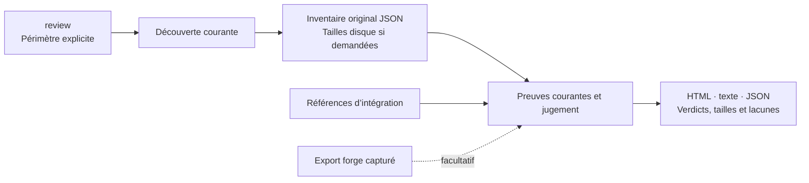
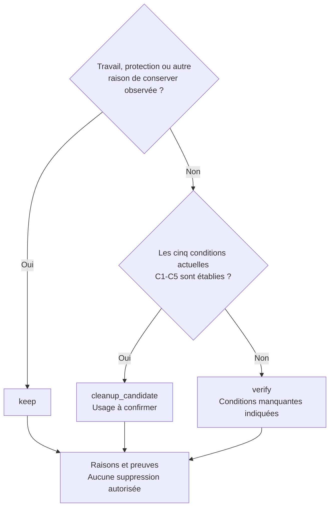

# Worktree Sweep

[English](README.md) · **Français**

**Disque plein : retrouvez les worktrees qui prennent de la place et le travail à conserver.**

<table>
  <tr>
    <td width="64">
      <a href="https://www.florian.bruniaux.com/about/?utm_source=github&amp;utm_medium=readme&amp;utm_campaign=wt-sweep"></a>
    </td>
    <td>
      <strong><a href="https://www.florian.bruniaux.com/about/?utm_source=github&amp;utm_medium=readme&amp;utm_campaign=wt-sweep">Florian BRUNIAUX</a></strong> &middot; AI Founding Engineer @ <a href="https://methode-aristote.fr/">Méthode Aristote</a><br />
      13 ans de parcours, de développeur à CTO / VP Eng &middot; <a href="https://www.florian.bruniaux.com/blog/?utm_source=github&amp;utm_medium=readme&amp;utm_campaign=wt-sweep">Blog &#8599;</a> &middot; <a href="https://www.florian.bruniaux.com/projects/?utm_source=github&amp;utm_medium=readme&amp;utm_campaign=wt-sweep">Projets &#8599;</a>
    </td>
  </tr>
</table>

[](https://github.com/FlorianBruniaux/wt-sweep/actions/workflows/ci.yml)
[](rust-toolchain.toml)
[](docs/getting-started.md#prerequisites)
[](LICENSE.md)


Une CLI locale pour macOS qui réunit **chemins, branches, tailles disque et
preuves Git** dans un rapport. Elle fonctionne sans modèle d’IA, service permanent
ni compte GitHub ou GitLab.

> [!NOTE]
> **Lecture seule.** Sweep prépare le bilan de nettoyage. Sauvegarde, restauration
> et suppression sont indisponibles ; `apply` refuse toute invocation.

[Démarrage rapide](#démarrage-rapide) · [Lire le résultat](#lire-le-résultat) · [Rapport HTML](#rapport-html) · [Skill assistant](#utiliser-avec-claude-ou-codex) · [Documentation](#documentation) · [Feuille de route](#feuille-de-route-et-validation)

---

## Pourquoi cet outil

J’ai créé Sweep parce que je n’avais plus de place sur mon disque. Mes worktrees
étaient dispersés entre les dossiers des projets et ceux des agents. Avant de
supprimer quoi que ce soit, je voulais savoir où partait l’espace et quels
dossiers contenaient encore du travail local.

| Ce que vous voulez savoir | Ce que le rapport montre |
| --- | --- |
| **Où sont mes worktrees ?** | Chemins et branches, regroupés par famille Git dans les racines choisies. |
| **Lesquels prennent de la place ?** | Tailles logiques et allouées, stockage Git partagé et mesures incomplètes. |
| **Lesquels examiner pour faire le ménage ?** | Preuves d’intégration, modifications locales, historique privé et raison de chaque verdict. |

La taille aide à choisir par où commencer. Elle ne prouve pas qu’un worktree
peut être supprimé et ne prédit pas le gain sur APFS. Une branche fusionnée peut
encore contenir des fichiers ignorés, des modifications non commitées ou des notes.

---

## Démarrage rapide

### Compiler depuis les sources

Utilisez macOS et Rust. Le repo est public et peut être cloné en HTTPS.

```sh
git clone https://github.com/FlorianBruniaux/wt-sweep.git
cd wt-sweep
cargo fetch --locked
cargo build --release --locked --offline
./target/release/wt-sweep --help
```

<details>
<summary>Prérequis et compilation hors ligne</summary>

Le repo fixe Rust 1.95.0 dans [rust-toolchain.toml](rust-toolchain.toml).
Passez `cargo fetch` si les dépendances sont déjà en cache. Git est lu via
`/usr/bin/git`. Aucune installation par gestionnaire de paquets ni configuration
globale n’est requise. [Installation et dépannage](docs/getting-started.md).

</details>

### Examiner un repo et ses worktrees

Depuis le checkout de Sweep, saisissez le chemin du clone et la référence
d’intégration confirmée, par exemple `refs/heads/main` ou `refs/heads/develop`.
Le bloc s’arrête si cette référence manque localement.

```sh
(
  set -eu
  sweep_bin="$PWD/target/release/wt-sweep"
  printf 'Chemin absolu du clone : '
  IFS= read -r repo_path
  printf 'Référence complète confirmée (refs/heads/... ou refs/remotes/...) : '
  IFS= read -r target_ref
  /usr/bin/git --no-optional-locks -c core.fsmonitor=false -C "$repo_path" \
    show-ref --verify --quiet "$target_ref"
  report_dir="$(mktemp -d /private/tmp/wt-sweep-report.XXXXXX)"
  "$sweep_bin" review --repo "$repo_path" --target "$target_ref" \
    --summary --disk-usage --html --run-dir "$report_dir"
  printf 'Rapports : %s\n' "$report_dir"
  open "$report_dir"/run-*/report.html
)
```

Gardez `XXXXXX` tel quel : `mktemp` le remplace par un suffixe unique. Les rapports
doivent être hors des repos inspectés et de leurs administrations Git.
Pour essayer d’abord sur des worktrees synthétiques, suivez la
[démo sur repo de test temporaire](docs/tutorial.fr.md#3-essayer-les-trois-verdicts-sur-un-repo-de-test-temporaire).

<details>
<summary>Fichiers produits et analyse de plusieurs projets</summary>

Chaque nouveau dossier `run-*` contient `inventory.json`, `review.json`,
`report.txt`, le `report.html` demandé et le reçu de publication `run.json`.
Le reçu de publication (`run.json`) consigne les tailles et les empreintes des fichiers produits. Un manifeste enregistre
des observations, pas des copies de vos fichiers.

Pour plusieurs dossiers de projets, commencez par des [racines explicites](docs/getting-started.md#inspect-selected-roots),
puis [choisissez les cibles d’intégration par famille](docs/targets-and-filters.md).
La CLI propose aussi `--all` ; les chemins inaccessibles et limites restent
des lacunes de couverture. Un parcours terminé ne prouve pas un instantané de
toute la machine.

Pour un inventaire sauvegardé ou des manifestes détaillés, suivez le
[parcours scan puis plan](docs/tutorial.fr.md#parcours-avancé-scan-puis-plan).
La découverte de racines explicites peut reprendre depuis un [checkpoint](docs/discovery-resume.md).

</details>

### Lire le résultat

`--summary` affiche verdicts, tailles et contrôles manquants. Ouvrez `report.html`
pour la vue regroupée ou `report.txt` pour toutes les raisons.

| Verdict | Signification | Suite utile |
| --- | --- | --- |
| `keep` | Du travail, une protection, une opération ou une autre raison de conserver a été observée. | Lire ce qui doit être préservé. |
| `verify` | Des preuves nécessaires manquent ou se contredisent. | Examiner la lacune et choisir un contrôle ciblé. |
| `cleanup_candidate` | Les cinq conditions actuelles C1–C5 sont satisfaites. | Vérifier si le worktree est encore utilisé ; ce verdict n’autorise pas la suppression. |

<details>
<summary>Pourquoi un résultat peut être partiel ou UNKNOWN</summary>

La collecte a des limites d’entrées, de volume et de temps. Un dossier non lu,
un refus d’accès ou un délai dépassé reste visible ; il ne devient jamais un
résultat vide. Les comptes partiels sont des bornes minimales. `UNKNOWN` signifie
que la preuve n’a pas été établie.

Commencez avec le budget `standard`. Pour une ligne non résolue, lisez les lacunes
puis envisagez [`--worktree PATH --budget thorough`](docs/targets-and-filters.md#complete-the-evidence-for-one-worktree).
Le disque possède son propre périmètre et budget : associez `--disk-usage` à
`--disk-root CHEMIN_ABSOLU` pour mesurer une racine enregistrée précise. Des
plafonds plus grands ne garantissent pas la complétude. [Mesure et reprises](docs/disk-usage.md).

Les couleurs et icônes du terminal sont automatiques. Ajoutez `--verbose` pour
les logs et durées par phase, ou `--color never` pour une sortie sobre. Les
fichiers enregistrés et le JSON ne contiennent pas de décoration terminal.

</details>

---

## Rapport HTML

Recherchez un chemin ou une branche, filtrez les verdicts, triez par taille et
copiez les chemins. Les worktrees sont regroupés par famille Git : thèmes clair
et sombre, tailles en Ko/Mo/Go, sections dépliables. Les totaux source, les lignes
sélectionnées et celles filtrées dans le navigateur restent distincts.

<details>
<summary>Voir le rapport en thème clair ou sombre</summary>

<picture>
  <source media="(prefers-color-scheme: dark)" srcset="docs/assets/report-dark.png" />
  
</picture>

Capture du rapport généré sur un repo de test : quatre worktrees, trois `keep` et un
`cleanup_candidate`. Réalisée le 8 octobre 2026, sans scan de votre machine.
[Provenance des captures](docs/assets/README.md#current-html-report).

</details>

<details>
<summary>Voir les branches, tailles disque et boutons de copie</summary>

<picture>
  <source media="(prefers-color-scheme: dark)" srcset="docs/assets/report-details-dark.png" />
  
</picture>

</details>

Le rapport fonctionne hors ligne ; ses sections de détail restent accessibles
sans JavaScript.
La recherche, le tri et la copie utilisent JavaScript. Le rapport est en anglais.
[Guide HTML](docs/html-report-plan.md) · [Provenance des illustrations et captures](docs/assets/README.md)

---

## Utiliser avec Claude ou Codex

Pour partir de zéro, donnez à votre assistant le [prompt d’installation et
d’analyse guidée](docs/bootstrap-prompt.fr.md#prompt-à-copier) : récupération
de l’outil et des skills, compilation, démo sur un repo de test puis premier rapport.

Ouvrez votre assistant **dans ce checkout de Sweep**, puis invoquez `/wt-sweep`
dans Claude Code ou `$wt-sweep` dans Codex. Le skill inclus lit les rapports par
petits groupes et propose les contrôles suivants. La CLI calcule les verdicts ;
l’assistant les explique. La découverte native du skill dépend du client et de
la confiance accordée au projet.

<details>
<summary>Copier un prompt d’exemple</summary>

Remplacez le chemin et confirmez la cible avant utilisation.
Dans Claude Code, remplacez `$wt-sweep` par `/wt-sweep`.

```text
$wt-sweep Analyse les worktrees du repo /chemin/absolu/du/depot.
La cible d’intégration confirmée est refs/heads/develop.
Mesure l’espace disque et génère un rapport HTML hors ligne.
Donne d’abord le bilan, puis lis cinq worktrees à la fois.
Conserve les verdicts de la CLI et explique les preuves manquantes. Propose
les contrôles suivants par priorité. Ne supprime rien et ne présente pas
les octets alloués comme un gain d’espace récupérable.
```

Le [guide assistant](docs/assistant-skill.md) couvre un rapport existant, les
reprises ciblées, le choix du modèle et du raisonnement, et la délégation bornée.
Sweep n’installe aucun skill global ni hook.

</details>

---

## Fonctionnalités

<details>
<summary>Capacités et commandes correspondantes</summary>

| Fonctionnalité | Utilité | Commande ou option |
| --- | --- | --- |
| Familles de repos | Repérer le worktree principal, les worktrees liés et ceux à HEAD détaché, ainsi que les worktrees enregistrés mais absents. | `scan --repo PATH` |
| Découverte ciblée | Parcourir les racines choisies, y compris les dossiers cachés, ignorés et imbriqués, en conservant les lacunes de couverture. | `scan --root PATH` |
| Découverte reprenable | Poursuivre le parcours de racines explicites, relire les familles Git et conserver les intervalles séparés. | [Commandes de reprise](docs/discovery-resume.md) |
| Revue en une commande | Découvrir le périmètre et collecter les preuves courantes du triage. | `review --repo PATH` |
| État local courant | Comparer HEAD, index et fichiers avec compteurs complets ou partiels. | `review` ou `plan` |
| Inventaires de fichiers locaux | Examiner les empreintes, métadonnées, entrées d’index et certains éléments d’administration du worktree. | `scan --local` |
| Relations Git | Vérifier l’identité de commits, l’ascendance et l’identité d’arbres par rapport aux références nommées. | `plan --target FULL_REF` |
| Preuves de forge hors ligne | Importer des données capturées depuis GitHub ou GitLab avec leur provenance, sans contacter de forge. | `forge ingerer` |
| Rapports texte et JSON | Lire le rapport détaillé ou le bilan structuré dans la console ; conserver les octets complets des chemins et les identifiants d’objets Git dans le JSON. | `--summary`, `--format json` |
| Espace disque | Mesurer les tailles logiques et allouées, fichiers ignorés inclus, avec résultats partiels et déduplication par inode. | `--disk-usage` |
| HTML hors ligne | Parcourir les worktrees par famille, chercher, trier et consulter les preuves capturées. | `--html --run-dir BASE` |
| Collecte ciblée | Consacrer le budget par worktree à un chemin choisi après lecture de ses lacunes. | `--worktree PATH --budget thorough` |
| Exécutions séparées | Conserver les rapports concurrents dans des dossiers distincts, avec les empreintes des fichiers produits et les horodatages de publication. | `--run-dir BASE` |

La découverte globale est également disponible via `scan --all` ou `review --all`. Elle utilise
les volumes montés visibles et signale les lacunes d’accès. Elle a été testée
avec des volumes injectés, sans scanner la machine de développement.
Commencez par un repo ou des racines choisies.

</details>

## Fonctionnement

La collecte lit le périmètre choisi ; le code déterministe classe les preuves
enregistrées. Une information manquante le reste. L’âge, un patch-id, une PR
fermée ou une suggestion de modèle ne prouvent pas l’intégration.

<details>
<summary>Du périmètre au rapport (Mermaid)</summary>



`review` combine découverte et collecte de preuves courantes. `scan` et `plan`
restent disponibles séparément. Les références sont explicites ; aucune branche
par défaut n’est devinée. Les exports de forge capturés sont facultatifs.
[Architecture](docs/architecture.md) · [Contrats de preuve](docs/contracts.md).

</details>

<details>
<summary>Règles de classification d’un worktree</summary>

Les raisons de conserver sont prioritaires. Seul un worktree lié avec des
contrôles actuels complets, une intégration vérifiée, un état local propre et un
historique couvert peut devenir candidat. L’absence d’export de forge ne suffit
pas à invalider ces preuves.



Le [tableau des classifications](#lire-le-résultat) et les
[contrats de preuve](docs/contracts.md#reviews-and-relationships) expliquent
comment interpréter ces résultats.

</details>

<details>
<summary>Mesure disque, lectures Git et limites de collecte</summary>

Les mesures disque incluent les fichiers ignorés et distinguent taille logique,
taille allouée et totaux dédupliqués par inode. Le stockage Git partagé est
mesuré séparément. Le HTML utilise les unités décimales Ko/Mo/Go et conserve les
octets exacts dans les détails. Les clones APFS empêchent d’en déduire le gain
après suppression.

Les octets des objets Git sont vérifiés contre leurs identifiants complets. Les
contrôles locaux distinguent index, fichiers modifiés, conflits, fichiers non
suivis et ignorés. L’historique privé et les stashes partagés restent dans les
preuves. Les sujets de commits et changelogs apportent du contexte, pas une
preuve d’intégration.

Sur macOS, Sweep vérifie que la matérialisation des fichiers non résidents
(dataless) est désactivée avant les lectures protégées, processus Git compris,
ou refuse l’opération. Erreurs et délais dépassés restent dans le rapport. Les
observations couvrent un intervalle, pas un instantané atomique.

[Guide disque](docs/disk-usage.md) · [Performances de collecte](docs/collection-performance.md)
· [Limites des lectures natives](docs/native-boundaries.md).

</details>

---

## Documentation

| Guide | Utilité |
| --- | --- |
| [Tutoriel en français](docs/tutorial.fr.md) | Repo de test temporaire, tests locaux et premier repo réel |
| [Démarrage](docs/getting-started.md) | Installation et dépannage |
| [Référence CLI](docs/cli.md) | Commandes, valeurs par défaut, limites et codes de sortie |
| [Espace disque](docs/disk-usage.md) | Tailles, résultats partiels et mesures ciblées |
| [Skill assistant](docs/assistant-skill.md) | Prompts d’exemple et lecture progressive |
| [Index documentaire](docs/README.md) | Guides, contrats, architecture et validations |

La présentation existe en français et en anglais. Le tutoriel et les guides
assistant et disque sont en français ; les autres guides gardent leur langue d’origine.

---

## Feuille de route et validation

L’audit en lecture seule est livré : HTML, disque ciblé, lectures Git groupées et
découverte reprenable. La suite porte sur l’évaluation du collecteur disque natif
macOS dans [#20](https://github.com/FlorianBruniaux/wt-sweep/issues/20).
La gestion des worktrees reste une [vision séparée dans #14](https://github.com/FlorianBruniaux/wt-sweep/issues/14).

<details>
<summary>Ce qui a été validé et ce qui reste ouvert</summary>

La [recette du 9 octobre](docs/research/real-family-acceptance-2026-10-09.md)
couvre une famille réelle de 71 worktrees enregistrés. La revue initiale donne
10 `keep`, 61 `verify`, aucun candidat. Les observations ciblées ultérieures ne
transforment pas cette revue partielle en instantané complet. Cinq worktrees
prioritaires ont une mesure disque complète ; le total familial reste partiel.

L’arbre source fusionné par [#23](https://github.com/FlorianBruniaux/wt-sweep/pull/23)
a passé localement 404 tests Rust (3 ignorés) et 305 cas Python (299 réussis,
6 ignorés). Ces contrôles datés portent sur cet arbre source ; ce ne sont pas
de nouveaux résultats liés à cette retouche du README. Le [registre](docs/progress.md)
conserve l’échec intermittent d’un test Rust et ses relances réussies, et sépare
tests locaux et CI distante. Le job de main consigné n’a pas démarré à cause du
paiement ou du plafond du compte. Le badge CI renvoie au dernier état du workflow.

L’exclusion des écritures concurrentes, la sauvegarde durable et la restauration
indépendante restent non démontrées. La suppression est indisponible. Les vrais
placeholders FileProvider, refus TCC et instantanés machine restent non vérifiés.
[Plan d’acceptation](docs/plan.md) · [Pourquoi apply est indisponible](docs/decisions/apply-readiness.md)
· [Travail restant](docs/roadmap.md).

</details>

## Développement et état du projet

La première alpha vise `v0.1.0-alpha.1`. La [préparation de la release](docs/release.md)
détaille son périmètre, les contrôles d’installation et l’état de publication.

Consultez [CONTRIBUTING.md](CONTRIBUTING.md) pour les contrôles locaux et repos
de test temporaires, puis [CHANGELOG.md](CHANGELOG.md) pour les changements. Le nom du projet
est provisoire ; il se distribue par ses sources. Aucun paquet n’a été publié et
la publication Cargo est désactivée.

---

## Licence

[Functional Source License 1.1, avec future licence Apache 2.0](LICENSE.md)
(`FSL-1.1-ALv2`), copyright 2026 Florian Bruniaux.
Les dépendances tierces conservent leurs propres licences.
