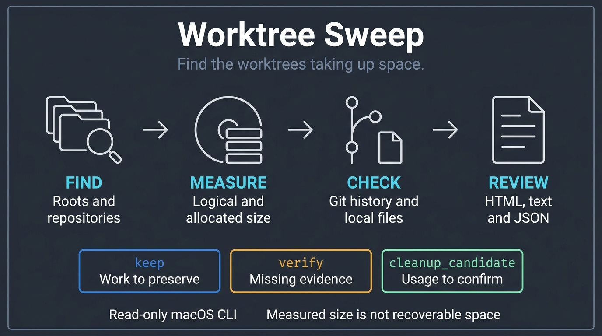
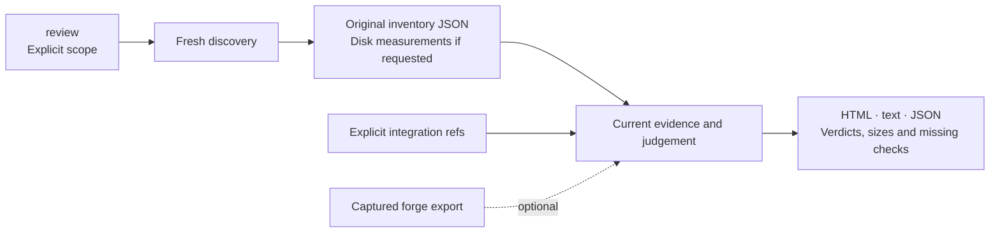
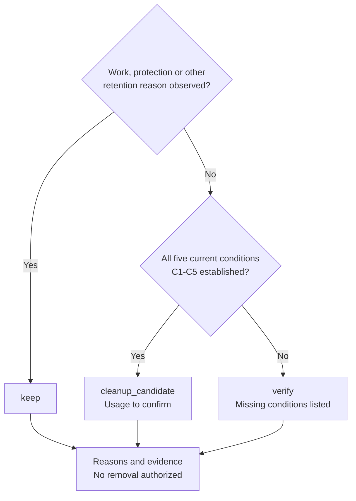

# Worktree Sweep

**English** · [Français](README.fr.md)

**Find the worktrees taking up disk space and the work you need to keep.**

<table>
  <tr>
    <td width="64">
      <a href="https://www.florian.bruniaux.com/about/?utm_source=github&amp;utm_medium=readme&amp;utm_campaign=wt-sweep"></a>
    </td>
    <td>
      <strong><a href="https://www.florian.bruniaux.com/about/?utm_source=github&amp;utm_medium=readme&amp;utm_campaign=wt-sweep">Florian BRUNIAUX</a></strong> &middot; AI Founding Engineer @ <a href="https://methode-aristote.fr/">Méthode Aristote</a><br />
      13 years from developer to CTO / VP Eng &middot; <a href="https://www.florian.bruniaux.com/blog/?utm_source=github&amp;utm_medium=readme&amp;utm_campaign=wt-sweep">Blog &#8599;</a> &middot; <a href="https://www.florian.bruniaux.com/projects/?utm_source=github&amp;utm_medium=readme&amp;utm_campaign=wt-sweep">Projects &#8599;</a>
    </td>
  </tr>
</table>

[](https://github.com/FlorianBruniaux/wt-sweep/actions/workflows/ci.yml)
[](rust-toolchain.toml)
[](docs/getting-started.md#prerequisites)
[](LICENSE.md)



A local macOS CLI that brings **paths, branches, disk sizes and Git evidence**
into one report. No AI model, service or forge account is needed.

> [!NOTE]
> **Read-only.** Sweep prepares a cleanup review. Backup, restore and removal
> are unavailable; `apply` refuses every invocation.

[Quick start](#quick-start) · [Read the result](#read-the-result) · [HTML report](#html-report) · [Assistant skill](#use-with-claude-or-codex) · [Documentation](#documentation) · [Roadmap](#roadmap-and-validation)

---

## Why it exists

I built Sweep because I had run out of disk space. My worktrees were scattered
across project folders and agent directories. Before deleting anything, I needed
to know where the space went and which directories still held local work.

| What you need to know | What the report shows |
| --- | --- |
| **Where are my worktrees?** | Paths and branches, grouped by Git family within the roots you choose. |
| **Which ones take up space?** | Logical and allocated sizes, shared Git storage and incomplete measurements. |
| **Which ones deserve a cleanup review?** | Integration evidence, local changes, private history and the reason for each verdict. |

Size helps prioritize the review. It does not prove a worktree can be removed or
predict the space recovered on APFS. A merged branch can still hold ignored
files, uncommitted changes or local notes.

---

## Quick start

### Build from source

Use macOS and Rust. The repository is public; clone it over HTTPS.

```sh
git clone https://github.com/FlorianBruniaux/wt-sweep.git
cd wt-sweep
cargo fetch --locked
cargo build --release --locked --offline
./target/release/wt-sweep --help
```

<details>
<summary>Prerequisites and offline builds</summary>

The repository pins Rust 1.95.0 in [rust-toolchain.toml](rust-toolchain.toml).
Skip `cargo fetch` when dependencies are already cached. Git is read through
`/usr/bin/git`. No package-manager install or global configuration is required.
[Setup and troubleshooting](docs/getting-started.md).

</details>

### Inspect one repository family

Run from the Sweep checkout. Enter your clone path and the full integration ref
you have confirmed, such as `refs/heads/main` or `refs/heads/develop`.
The command stops if that ref is absent locally.

```sh
(
  set -eu
  sweep_bin="$PWD/target/release/wt-sweep"
  printf 'Absolute clone path: '
  IFS= read -r repo_path
  printf 'Confirmed full target ref (refs/heads/... or refs/remotes/...): '
  IFS= read -r target_ref
  /usr/bin/git --no-optional-locks -c core.fsmonitor=false -C "$repo_path" \
    show-ref --verify --quiet "$target_ref"
  "$sweep_bin" review --repo "$repo_path" --target "$target_ref" \
    --summary --disk-usage --open
)
```

`--open` saves HTML, text and JSON under `~/Desktop/Worktree Sweep/run-*/`
and asks macOS to open the HTML. Use `--html` to save without opening, or add
`--run-dir "/absolute/path/to/reports"` to choose an existing directory.
Reports must remain outside the inspected scope and Git directories.
To try synthetic worktrees first, use the [disposable demo](docs/getting-started.md#disposable-demo).

<details>
<summary>What is saved, and how to inspect several projects</summary>

Each new `run-*` directory contains `inventory.json`, `review.json`,
`report.txt`, the requested `report.html` and the publication receipt `run.json`.
The receipt records artifact sizes and hashes. A manifest records observations,
not copies of your files.

For several project folders, start with [explicit roots](docs/getting-started.md#inspect-selected-roots),
then [select the integration refs per family](docs/targets-and-filters.md).
The CLI also exposes `--all`; inaccessible paths and limits remain coverage gaps.
A completed walk does not prove a machine-wide snapshot.

For saved inventories and detailed file manifests, follow the
[scan then plan workflow](docs/tutorial.fr.md#parcours-avancé-scan-puis-plan).
Interrupted explicit-root discovery can use [checkpoints](docs/discovery-resume.md).

</details>

### Read the result

`--summary` starts with disk allocation, then separates commit ancestry from
cleanup verdicts. It lists the five largest measured worktrees in the selected
view, their blockers and a focused retry command when the recorded path and
targets can be quoted safely. Output is in English; sizes use decimal KB/MB/GB.
Open `report.html` for the grouped view or `report.txt` for the full reasons.

An ancestor relationship can be known while a worktree still needs verification:
local files, object availability or private history may remain unchecked.
The compact recap names collection limits; `--verbose` adds technical timings.

| Verdict | Meaning | Next step |
| --- | --- | --- |
| `keep` | Work, a protection, an operation or another retention reason was observed. | Read what must be preserved. |
| `verify` | Required evidence is missing or inconsistent. | Inspect the gap and choose a focused check. |
| `cleanup_candidate` | The five current evidence conditions C1–C5 are satisfied. | Confirm usage; this verdict does not authorize removal. |

<details>
<summary>Why a result can be partial or UNKNOWN</summary>

Collection has finite entry, byte and time limits. An unread directory, an
access error or a timeout remains visible; it never becomes an empty result.
Partial counts are lower bounds. `UNKNOWN` means the evidence was not established.

Start with the default `standard` budget. For an unresolved row, read its gaps
and consider [`--worktree PATH --budget thorough`](docs/targets-and-filters.md#complete-the-evidence-for-one-worktree).
Disk measurement has a separate scope and budget: use `--disk-usage` with
`--disk-root ABSOLUTE_PATH` to target a registered root. Larger caps do not
guarantee completion. [Disk measurements and retries](docs/disk-usage.md).

Terminal colors and icons are automatic. Add `--verbose` for detailed logs and
phase timings, or `--color never` for plain output. Saved reports and JSON do not
contain terminal decoration.

</details>

---

## HTML report

Search by path or branch, filter verdicts, sort by size and copy paths. Worktrees
are grouped by Git family, with light/dark themes, sizes in Ko/Mo/Go and expandable
sections. Source totals, selected rows and browser-filtered rows remain distinct.

<details>
<summary>Preview the report in light or dark mode</summary>

<picture>
  <source media="(prefers-color-scheme: dark)" srcset="docs/assets/report-dark.png" />
  
</picture>

Native capture from a disposable four-worktree demo: three `keep`, one
`cleanup_candidate`. Captured on 8 October 2026, not a scan of your machine.
[Capture provenance](docs/assets/README.md#current-html-report).

</details>

<details>
<summary>Preview branches, disk sizes and copy buttons</summary>

<picture>
  <source media="(prefers-color-scheme: dark)" srcset="docs/assets/report-details-dark.png" />
  
</picture>

</details>

The report and its expandable evidence work offline without JavaScript.
Search, sorting and path copying use JavaScript. Review reports also link to
GitHub/GitLab repositories, branches and commits from local remotes. Add
`--forge FILE` to show associated captured PR/MR links and states. These links
do not confirm publication; the CLI does not contact the server.
[Forge links and imports](docs/forge.md#links-in-review-reports).
[HTML guide](docs/html-report-plan.md) · [Illustration and screenshot provenance](docs/assets/README.md)

---

## Use with Claude or Codex

Starting from scratch? Give your assistant the [installation and guided-review
prompt (French)](docs/bootstrap-prompt.fr.md#prompt-à-copier). It covers cloning
the tool and bundled skills, building the CLI, a disposable demo and your first report.

Open your assistant **in this Sweep checkout** and invoke `/wt-sweep` in Claude
Code or `$wt-sweep` in Codex. The included skill reads reports in small batches
and suggests the next checks. The CLI computes the verdicts; the assistant
explains them. Native skill discovery depends on your client and project trust.

<details>
<summary>Copy an example prompt</summary>

Replace the path and confirm the target ref before using this prompt.
Use `/wt-sweep` instead of `$wt-sweep` in Claude Code.

```text
$wt-sweep Review the worktrees of /absolute/path/to/repository.
The confirmed integration target is refs/heads/develop.
Measure disk usage and generate an offline HTML report.
Start with the recap, then read five worktrees at a time.
Keep the CLI verdicts and explain missing evidence. Suggest the next checks
in priority order. Do not delete anything or treat allocated bytes as savings.
```

The [assistant guide](docs/assistant-skill.md) covers an existing report, targeted
retries, model/effort choices and bounded delegation. No global skill or hook
installation is performed by Sweep.

</details>

---

## Features

<details>
<summary>Capabilities and CLI entry points</summary>

| Capability | Use it for | Entry point |
| --- | --- | --- |
| Repository families | Discover the main checkout, linked and detached worktrees, and missing registrations. | `scan --repo PATH` |
| Scoped discovery | Walk selected roots, including hidden, ignored and nested directories, with coverage gaps retained. | `scan --root PATH` |
| Resumable discovery | Continue a saved explicit-root traversal; reread Git families and retain separate observation intervals. | [Checkpoint commands](docs/discovery-resume.md) |
| One-command review | Discover an explicit scope and collect current review evidence. | `review --repo PATH` |
| Current local state | Compare HEAD, index and files with separate complete or partial counts. | `review` or `plan` |
| Local file manifests | Inspect file hashes, metadata, index entries and selected worktree administration. | `scan --local` |
| Git relationships | Observe identical commits, ancestry and identical trees against named refs. | `plan --target FULL_REF` |
| Offline forge evidence | Import captured GitHub/GitLab data with provenance, without contacting a forge. | `forge ingerer` |
| Human and machine output | Read the detailed report or structured console recap; retain full path bytes and OIDs in JSON. | `--summary`, `--format json` |
| Disk usage | Measure logical and allocated sizes, including ignored files, with partial results and inode deduplication. | `--disk-usage` |
| Offline HTML | Browse worktrees by family, search, sort and inspect captured evidence. | `--open` or `--html` |
| Focused collection | Spend the per-worktree allowance on one selected path after reading its gaps. | `--worktree PATH --budget thorough` |
| Separate runs | Keep concurrent reports in distinct directories with artifact hashes and publication timestamps. | `--run-dir BASE` |

Global discovery is also available through `scan --all` and `review --all`. It uses visible mounted
volumes and reports access gaps. It has been tested with injected volumes, not
by scanning the development machine. Start with a repository or selected roots.

</details>

## How it works

Collection reads the chosen scope; deterministic code classifies the recorded
evidence. Missing information stays missing. Age, patch-id, a closed PR or a
model suggestion cannot prove integration.

<details>
<summary>From scope to report (Mermaid)</summary>



`review` combines discovery and current evidence collection. `scan` and `plan`
remain available separately. Integration refs are explicit; no default branch
is guessed. Captured forge exports are optional.
[Architecture](docs/architecture.md) · [Evidence contracts](docs/contracts.md).

</details>

<details>
<summary>How a worktree is classified</summary>

Retention reasons take priority. Only a linked worktree with complete current
controls, verified integration, clean files and covered private history qualifies.
A missing optional forge export does not invalidate those proofs.



The [classification table](#read-the-result) and [evidence contracts](docs/contracts.md#reviews-and-relationships)
describe how to read these results.

</details>

<details>
<summary>Disk accounting, Git reads and collection limits</summary>

Disk measurements include ignored files and distinguish logical size, allocated
size and inode-deduplicated totals. Shared Git storage is recorded separately.
HTML uses decimal Ko/Mo/Go and keeps exact bytes in the details. APFS clones
prevent these figures from establishing recoverable space.

Git object bytes are checked against their full OIDs. Local checks distinguish
staged, unstaged, conflicted, untracked and ignored paths. Private history and
shared stashes remain part of the evidence. Commit messages and changelogs
provide context, not integration proof.

On macOS, Sweep verifies that dataless-file materialization is disabled before
protected reads, including Git children, or refuses the operation. Access errors
and timeouts stay in the report. Observations span an interval, not an atomic
snapshot.

[Disk guide](docs/disk-usage.md) · [Collection performance](docs/collection-performance.md)
· [Native read boundaries](docs/native-boundaries.md).

</details>

---

## Documentation

| Guide | Use it for |
| --- | --- |
| [Hands-on tutorial (French)](docs/tutorial.fr.md) | Disposable trial, local tests and first real repository |
| [Getting started](docs/getting-started.md) | Installation and troubleshooting |
| [CLI reference](docs/cli.md) | Commands, defaults, limits and exit codes |
| [Disk usage](docs/disk-usage.md) | Sizes, partial results and focused measurements |
| [Assistant skill](docs/assistant-skill.md) | Example prompts and progressive report reading |
| [Documentation index](docs/README.md) | All guides, contracts, architecture and validation records |

The overview is available in English and French. The tutorial, assistant and
disk guides are in French; other guides retain their original language.

---

## Roadmap and validation

The read-only audit is delivered: HTML reports, targeted disk measurement,
grouped Git reads and resumable discovery. The next task is the native macOS
disk collector evaluation in [#20](https://github.com/FlorianBruniaux/wt-sweep/issues/20).
Worktree management remains a separate [vision in #14](https://github.com/FlorianBruniaux/wt-sweep/issues/14).

<details>
<summary>What has been validated, and what remains open</summary>

The [9 October acceptance record](docs/research/real-family-acceptance-2026-10-09.md)
covers one real family with 71 registered worktrees. The first review returned
10 `keep`, 61 `verify` and no candidate. Later focused observations do not turn
that partial review into a complete snapshot. Five prioritized worktrees have
complete disk measurements; the family-wide total remains partial.

The source tree merged by [#23](https://github.com/FlorianBruniaux/wt-sweep/pull/23)
passed 404 Rust tests (3 ignored) and 305 Python cases (299 passed, 6 skipped)
locally. These are dated source-tree checks, not new results from this README
edit. The [validation record](docs/progress.md) records an intermittent Rust test
failure and its successful reruns, and separates local checks from remote CI.
The recorded main CI job did not start because of an account payment or spending
limit. The CI badge links to the latest workflow state.

Concurrent-writer exclusion, durable backup and independent restore remain
unproven. Removal is unavailable. Real FileProvider placeholders, actual TCC
denials and a machine-wide snapshot have not been verified.
[Acceptance plan](docs/plan.md) · [Why apply is unavailable](docs/decisions/apply-readiness.md)
· [Remaining work](docs/roadmap.md).

</details>

## Development and project status

The first alpha targets `v0.1.0-alpha.1`. See the [release preparation](docs/release.md)
for its scope, installation checks and publication status.

See [CONTRIBUTING.md](CONTRIBUTING.md) for local checks and disposable fixtures,
and [CHANGELOG.md](CHANGELOG.md) for changes. The project name is provisional;
the source checkout is the current distribution. No package release has been
published, and Cargo publishing is disabled.

---

## License

[Functional Source License 1.1, Apache 2.0 future license](LICENSE.md)
(`FSL-1.1-ALv2`), copyright 2026 Florian Bruniaux.
Third-party dependencies retain their own licenses.
