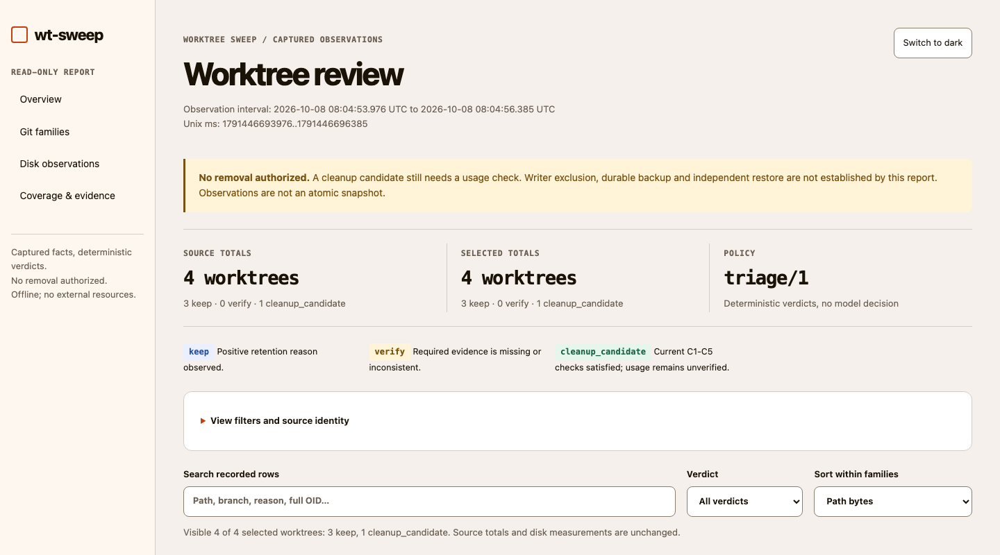
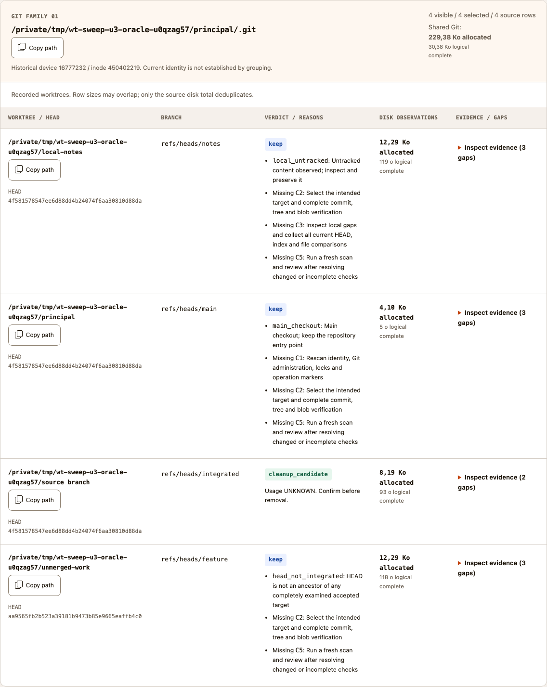
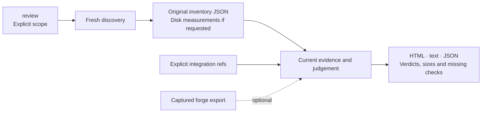
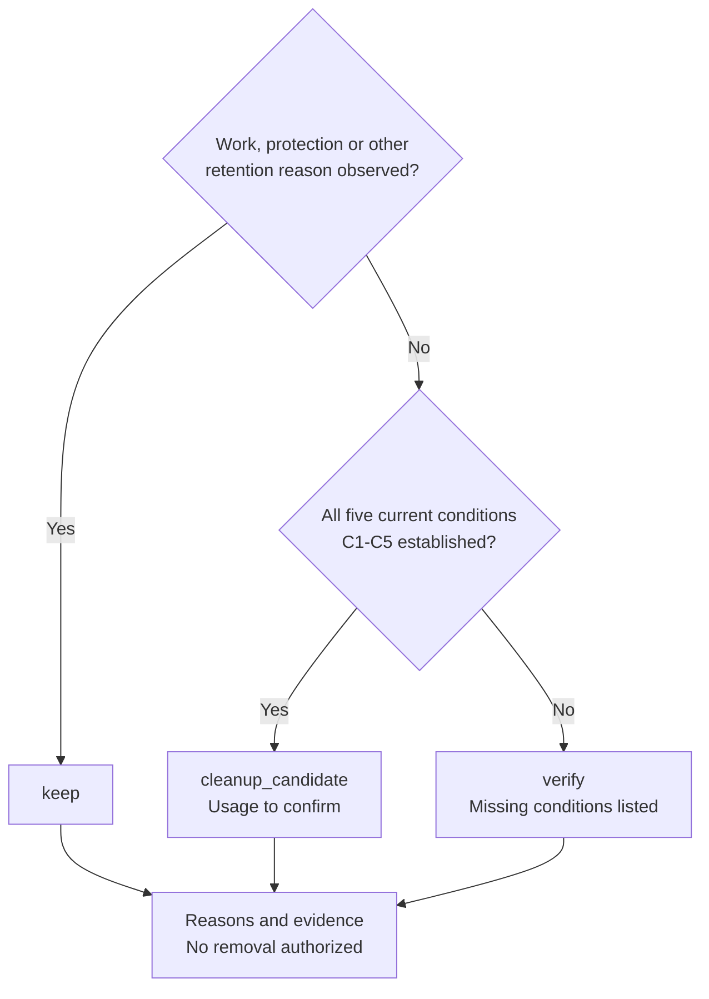

# Worktree Sweep

**English** · [Français](README.fr.md)

**Running out of disk space: find the worktrees to review and the work to keep.**

<table>
  <tr>
    <td width="64">
      <a href="https://www.florian.bruniaux.com/about/?utm_source=github&amp;utm_medium=readme&amp;utm_campaign=wt-sweep"></a>
    </td>
    <td>
      <strong><a href="https://www.florian.bruniaux.com/about/?utm_source=github&amp;utm_medium=readme&amp;utm_campaign=wt-sweep">Florian BRUNIAUX</a></strong> &middot; AI Founding Engineer @ <a href="https://methode-aristote.fr/">Méthode Aristote</a><br />
      13 years from developer to CTO / VP Eng &middot; <a href="https://www.florian.bruniaux.com/blog/?utm_source=github&amp;utm_medium=readme&amp;utm_campaign=wt-sweep">Blog &#8599;</a> &middot; <a href="https://www.florian.bruniaux.com/projects/?utm_source=github&amp;utm_medium=readme&amp;utm_campaign=wt-sweep">Projects &#8599;</a>
    </td>
  </tr>
</table>

---

[](https://github.com/FlorianBruniaux/wt-sweep/actions/workflows/ci.yml)
[](rust-toolchain.toml)
[](docs/getting-started.md#prerequisites)
[](LICENSE.md)

[Quick start](#quick-start) · [HTML report](#html-report) · [Features](#features) · [How it works](#how-it-works) · [Documentation](#documentation)

[Tutorial and tests](docs/tutorial.fr.md) · [Example prompt](docs/tutorial.fr.md#prompt-à-donner-à-un-assistant) · [Roadmap](docs/roadmap.md) · [Changelog](CHANGELOG.md) · [Contributing](CONTRIBUTING.md)

---

## Why it exists

I built Worktree Sweep because I had run out of disk space. Before cleaning up,
I needed to find my Git worktrees, measure their size and check which ones still
contained work worth keeping.

Worktrees can be spread across project folders and directories used by coding
agents. A merged branch can still contain uncommitted changes, ignored files or
local notes. Checking them one directory at a time means repeating Git commands
and piecing together the results.

Worktree Sweep (`wt-sweep`) brings that review into one report: paths, branches,
disk sizes and reasons to keep a worktree or investigate it further. It runs
locally on macOS, without an AI model, service or forge account.

## Start with the problem you have

| Your problem | What Sweep gives you | Where to start |
| --- | --- | --- |
| **No disk space left** | Measured sizes per worktree and shared Git storage, with missing or partial measurements identified. Sort the HTML report by size to choose what to inspect first. | [Review with disk usage](#inspect-one-repository-family) |
| **Worktrees scattered across folders** | An inventory grouped by Git family, with paths and branches. Discovery covers the roots you select and retains access gaps. | [Choose repositories or roots](docs/cli.md) |
| **Unsure which worktrees you can clean up** | Git integration checks, local changes and private-history evidence. The report separates work to keep, missing checks and cleanup candidates. | [Read the verdicts](#read-the-result) |

Size helps prioritize the review; it does not prove a worktree can be removed.
On APFS, measured allocation is not an estimate of space you would recover.
A cleanup candidate still needs confirmation that no agent or terminal is using it.

> [!NOTE]
> **Read-only MVP for macOS.** Sweep prepares a cleanup review; it does not free
> disk space itself. Backup, restore and removal are unavailable, and `apply`
> refuses every invocation. The project name is provisional and no release has
> been published.

---

## HTML report

<picture>
  <source media="(prefers-color-scheme: dark)" srcset="docs/assets/report-dark.png" />
  
</picture>

Actual CLI output from a disposable demo, using this checkout's BoldGuy theme.
The demo has four worktrees: three to keep and one candidate whose use still
needs confirmation. These are synthetic results, not a scan of your machine.
[Capture provenance and earlier illustrations](docs/assets/README.md).

The report groups worktrees by Git family. Search, verdict filters, size sorting
and expandable evidence help narrow the review. Light/dark themes, sizes in
Ko/Mo/Go, **Copy path** buttons, navigation help and collapsible report sections
are merged in `main` through [PR #18](https://github.com/FlorianBruniaux/wt-sweep/pull/18).
The report and expandable evidence work offline and without JavaScript.
Search, sorting and path copying require JavaScript.

<details>
<summary>See worktree rows, disk sizes and copy buttons</summary>

<picture>
  <source media="(prefers-color-scheme: dark)" srcset="docs/assets/report-details-dark.png" />
  
</picture>

</details>

---

## Quick start

### Build from source

On macOS with Rust installed, clone the repository and build the CLI.
The repository is currently private, so cloning requires GitHub access:

```sh
git clone https://github.com/FlorianBruniaux/wt-sweep.git
cd wt-sweep
cargo fetch --locked
cargo build --release --locked --offline
./target/release/wt-sweep --help
```

<details>
<summary>Build prerequisites and offline dependencies</summary>

If you already have a checkout, run the build commands from its root.
The repository pins Rust 1.95.0 in [rust-toolchain.toml](rust-toolchain.toml).
Fetching dependencies needs network access; skip that step when they are already
cached. Git is read through `/usr/bin/git`. There is no package-manager install
or global configuration step. See [setup and troubleshooting](docs/getting-started.md).

</details>

### Inspect one repository family

Run from the `wt-sweep` checkout after building. Enter the clone path and the
integration ref you have confirmed. The block stops if that ref is absent locally.

```sh
(
  set -eu
  sweep_bin="$PWD/target/release/wt-sweep"
  printf 'Absolute clone path: '
  IFS= read -r repo_path
  printf 'Confirmed full target ref (refs/heads/... or refs/remotes/...): '
  IFS= read -r target_ref
  /usr/bin/git --no-optional-locks -c core.fsmonitor=false -C "$repo_path" \
    show-ref --verify --quiet "$target_ref"
  report_dir="$(mktemp -d /private/tmp/wt-sweep-report.XXXXXX)"
  "$sweep_bin" review --repo "$repo_path" --target "$target_ref" \
    --summary --disk-usage --html --run-dir "$report_dir"
  printf 'Reports: %s\n' "$report_dir"
  open "$report_dir"/run-*/report.html
)
```

Keep `XXXXXX` literally: `mktemp` replaces it with a unique suffix. The report
base must be outside the repository, its registered worktrees and Git
administration. `review` discovers the family and collects current evidence in
one command. Its new run directory contains the original `inventory.json`,
`review.json`, full `report.txt`, offline `report.html` and publication receipt
`run.json`. The HTML groups worktrees by Git family and offers search, sorting
and collapsible evidence. Its totals distinguish source, selected and visible rows.
Copy a path directly from its row; if clipboard access is refused, the report
selects the text for manual copying. See the [HTML report guide](docs/html-report-plan.md).

For detailed file hashes, or to review a saved inventory separately, use the
[advanced scan and plan path](docs/tutorial.fr.md#parcours-avancé-scan-puis-plan).
A saved manifest records observations, not file contents.

### Read the result

Each row names the worktree, branch, full HEAD, local changes, history and verdict.
`--summary` prints a short recap with verdicts, disk sizes and missing checks.
Terminal colors and icons are automatic; progress updates one line. Add
`--verbose` for detailed logs and timings, or `--color never` for plain output.
The full reasons, paths and evidence remain in `report.txt`. JSON and saved files
contain no terminal decoration.

| Verdict | Meaning |
| --- | --- |
| `keep` | Work to preserve, a main checkout, a protection, an operation or another positive retention reason was observed. |
| `cleanup_candidate` | The current controls, Git integration, clean local state and private-history coverage satisfy all five conditions. |
| `verify` | Required evidence is missing or inconsistent. The report names the missing conditions. |

Candidates still require a usage check before removal. The report authorizes
no deletion and does not establish a complete backup. A merged HEAD alone cannot
qualify while local changes or exclusive reflog history remain.
See the [decision contract](docs/contracts.md#triage-policy) and
[disposable demo](docs/getting-started.md#disposable-demo).

---

## Use with Claude or Codex

The repository includes a `wt-sweep` skill for reading reports in small batches
and suggesting conservation or verification steps. Start Claude Code or Codex
in this checkout, invoke `/wt-sweep` or `$wt-sweep`, and provide the repository
path and confirmed integration ref. The skill preserves CLI verdicts and missing
evidence. Cleanup execution remains unavailable. Model/effort profiles and bounded
subagent delegation are described in the guide.

See the [assistant guide and example prompts](docs/assistant-skill.md) for a
fresh review, an existing report and a disposable local test.

Start with the default `standard` budget, then inspect the saved facts. For a
row stopped by those caps, use the [targeted collection recipe](docs/targets-and-filters.md#complete-the-evidence-for-one-worktree)
with `--worktree` and `--budget thorough`. Read that new result before choosing a
whole-family thorough run. Other rows and their missing checks remain visible.
The larger finite caps include ignored files and do not guarantee completion.

---

## Features

<details>
<summary>Capabilities and CLI entry points</summary>

| Capability | Use it for | Entry point |
| --- | --- | --- |
| Repository families | Discover the main checkout, linked and detached worktrees, and missing registrations. | `scan --repo PATH` |
| Scoped discovery | Walk selected roots, including hidden, ignored and nested directories, with coverage gaps retained. | `scan --root PATH` |
| Resumable discovery | Continue a saved explicit-root traversal; reread Git families and retain separate observation intervals. | [Checkpoint commands](docs/discovery-resume.md) |
| One-command review | Discover an explicit scope and collect current review evidence. | `review --repo PATH` |
| Current local state | Compare HEAD, index and files with separate complete or partial counts. | `review` or `plan` |
| Local file manifests | Inspect file hashes, metadata, index entries and selected worktree administration. | `scan --local` |
| Git relationships | Observe identical commits, ancestry and identical trees against named refs. | `plan --target FULL_REF` |
| Offline forge evidence | Import captured GitHub/GitLab data with provenance, without contacting a forge. | `forge ingerer` |
| Human and machine output | Read the detailed report or structured console recap; retain full path bytes and OIDs in JSON. | `--summary`, `--format json` |
| Disk usage | Measure logical and allocated sizes, including ignored files, with partial results and inode deduplication. | `--disk-usage` |
| Offline HTML | Browse worktrees by family, search, sort and inspect captured evidence. | `--html --run-dir BASE` |
| Focused collection | Spend the per-worktree allowance on one selected path after reading its gaps. | `--worktree PATH --budget thorough` |
| Separate runs | Keep concurrent reports in distinct directories with artifact hashes and publication timestamps. | `--run-dir BASE` |

Global discovery is also available through `scan --all` and `review --all`. It uses visible mounted
volumes and reports access gaps. It has been tested with injected volumes, not
by scanning the development machine. Start with a repository or selected roots.

</details>

---

## How it works

`review` combines discovery and review. The separate `scan` and `plan` commands
remain available for detailed manifests and saved-input workflows:



`review` and `plan` collect commit-graph facts and a fresh local summary, then reserve
deep object verification for possible candidates.
The detail distinguishes staged, unstaged, conflicted, untracked and ignored
paths. Partial counts are shown as lower bounds or `UNKNOWN`. Saved manifests
remain historical records; neither observation authorizes deletion.

<details>
<summary>How a worktree is classified</summary>

Retention reasons take priority. Only a linked worktree with complete current
controls, verified integration, clean files and covered private history qualifies.
A missing optional forge export does not invalidate those proofs.



The [classification table](#read-the-result) and [evidence contracts](docs/contracts.md#reviews-and-relationships)
describe how to read these results.

</details>

The collector limits how much it reads and how long operations can run. It
checks Git object bytes against their full OIDs before the review code
classifies the observations without further I/O. Age, patch-id, a closed MR
and a model suggestion cannot establish integration.

On macOS, the process disables and verifies dataless-file materialization before
protected reads, including its Git children. If that policy cannot be established,
the operation is refused. Access failures and timeouts remain visible. A completed
walk is still an interval of observations, not an atomic filesystem snapshot.

Discovery reports include elapsed time and entries per second. Review summaries
identify the slowest measured collection phase. The [performance guide and Rust
benchmark](docs/collection-performance.md#benchmark-rust-reproductible) explain
how to compare worker settings without losing coverage.

The [architecture](docs/architecture.md) and [evidence contracts](docs/contracts.md)
describe the read and publication boundaries.

---

**Disk usage:** add `--disk-usage` to `scan` or `review` for allocated and logical
sizes per worktree, shared Git storage and a deduplicated total. The CLI writes
these figures directly to the console recap, text report, JSON and optional HTML.
`--disk-root ABSOLUTE_PATH` restricts measurement to exact registered roots;
other roots remain listed as not requested. The remaining entry/time budget is
shared between roots still to visit. `plan` retains captured measurements.
Ignored files are included; incomplete measurements stay
visible. HTML uses decimal units (Ko/Mo/Go) and retains exact bytes in details.
Allocated bytes do not estimate recoverable APFS space. [Measure disk usage](docs/disk-usage.md).

## Documentation

| Start here | What it covers |
| --- | --- |
| [Hands-on tutorial (French)](docs/tutorial.fr.md) | Disposable trial, local tests, first real repository and a copyable assistant prompt |
| [Getting started](docs/getting-started.md) | Setup, disposable demo, report interpretation and troubleshooting |
| [HTML report](docs/html-report-plan.md) | Generation, navigation, themes, path copying and recorded evidence |
| [CLI reference](docs/cli.md) | Commands, defaults, output modes, limits and exit codes |
| [Targets and filters](docs/targets-and-filters.md) | Per-repository targets, filtering and grouped reports |
| [Offline forge imports](docs/forge.md) | Exports, executor receipts and association limits |
| [Evidence and JSON](docs/contracts.md) | Schema fields, path bytes, digests and run receipts |
| [Architecture](docs/architecture.md) | Module responsibilities, read boundaries and test strategy |
| [Documentation index](docs/README.md) | All guides, design decisions and validation records |

This overview is available in English and French. The hands-on tutorial,
assistant and disk guides are in French; other user guides are in English.
Design, experiment and implementation records retain their original language.

---

## Roadmap and validation

The read-only audit milestone is delivered. Subsequent merges added the BoldGuy
HTML refinements ([#18](https://github.com/FlorianBruniaux/wt-sweep/pull/18)),
targeted disk collection and budget sharing ([#22](https://github.com/FlorianBruniaux/wt-sweep/pull/22)),
then grouped Git reads and resumable discovery
([#23](https://github.com/FlorianBruniaux/wt-sweep/pull/23)).

The [9 October acceptance record](docs/research/real-family-acceptance-2026-10-09.md)
covers one real family with 71 registered worktrees. The initial review returned
10 `keep`, 61 `verify` and no candidate. Two focused reviews changed those rows
to `keep`; combining the latest recorded verdict per path gives 12 / 59 / 0.
These separate observations are not a new CLI verdict or an atomic snapshot.
Five prioritized worktrees received complete disk measurements. The family-wide
53.64 Go allocation remains partial and does not estimate recoverable APFS space.

Next is [#20](https://github.com/FlorianBruniaux/wt-sweep/issues/20): evaluate a
native macOS disk collector against the current implementation. Its targeted
collection and budget-sharing requirements are already delivered; native bulk
collection still needs correctness, conservation and full-collector benchmarks.
Management options remain in [vision #14](https://github.com/FlorianBruniaux/wt-sweep/issues/14).
Backup, restore and removal remain unavailable.

As checked on 9 October, #23's pre-merge CI passed. The
[main run for `bc054af`](https://github.com/FlorianBruniaux/wt-sweep/actions/runs/37850898399)
did not start its job because of the account payment or spending limit.
The earlier CI issue #17 is closed; this later failure still needs an account
fix and a rerun. [Delivery and validation record](docs/progress.md#état-publié-et-suite-au-09102026).

<details>
<summary>Implementation stages and recorded validation</summary>

| Stage | Current state |
| --- | --- |
| U1–U4: discovery and review | Implemented and tested locally on macOS; evidence limits remain explicit. |
| T01-T09: worktree triage | Merged; one-command review, C1-C5 verdicts, local and private history, targets, filters and reports. |
| Large-repository coverage | Object reads are batched and retries can target one worktree; the recorded large-repository trial remains partial. |
| E1: exclude concurrent writers | **Not demonstrated.** Existing experiments defeat the proposed locking and rename approaches. |
| U5: durable backup and independent restore | Blocked on E1 and a complete preservation contract. |
| U6–U7: removal | Unavailable, pending fixture validation, independent review and exact human approval. |

The [acceptance plan](docs/plan.md) defines the gates. The
[apply decision](docs/decisions/apply-readiness.md) records why they remain closed.

The source tree merged by #23 passed 404 Rust tests (3 ignored) and 305 Python
cases (299 passed, 6 skipped) locally. These are recorded checks for that source
tree, not a new run on each documentation edit. The [validation record](docs/progress.md)
separates local checks, pre-merge CI and main CI. Historical checkpoints remain
in the [validation ledger](docs/finish-ledger.md#triage-t01-t09).
The CI badge links to remote workflow results, separate from local checks.
Real FileProvider placeholders, actual TCC denials and a machine-wide snapshot
have not been verified.

</details>

---

## Development and project status

See [CONTRIBUTING.md](CONTRIBUTING.md) for the build, test commands, disposable
fixtures and documentation conventions. The [changelog](CHANGELOG.md) tracks
unreleased changes. The [executed comparison](docs/research/worktree-runtime-comparison-2026-10-07.md)
covers 48 native audits across Sweep, Holt and AgentRinse on disposable fixtures.
It does not validate recovery or removal.

The source checkout is the current distribution. Cargo publishing is disabled;
no package release has been published.

---

## License

[Functional Source License 1.1, Apache 2.0 future license](LICENSE.md)
(`FSL-1.1-ALv2`), copyright 2026 Florian Bruniaux. The same license is used by
Agent Router.

The FSL restricts competing commercial uses. Each version receives an additional
Apache 2.0 license two years after it is made available. Read the
[full terms](LICENSE.md) and the [FSL explanation](https://fsl.software/).
Third-party dependencies retain their own licenses.
