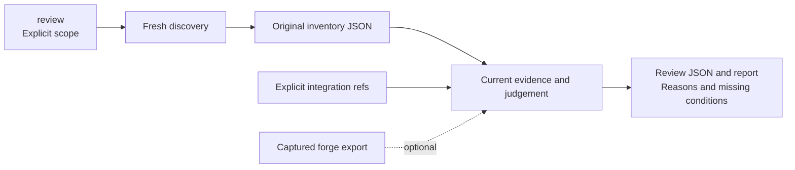
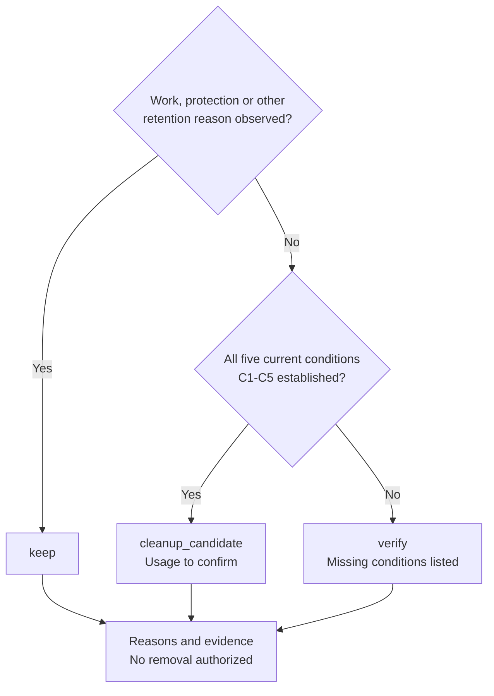

# Worktree Sweep

**English** · [Français](README.fr.md)

<table>
  <tr>
    <td width="64">
      <a href="https://www.florian.bruniaux.com/about/?utm_source=github&amp;utm_medium=readme&amp;utm_campaign=wt-sweep"></a>
    </td>
    <td>
      <strong><a href="https://www.florian.bruniaux.com/about/?utm_source=github&amp;utm_medium=readme&amp;utm_campaign=wt-sweep">Florian BRUNIAUX</a></strong> &middot; AI Founding Engineer @ <a href="https://methode-aristote.fr/">Méthode Aristote</a><br />
      13 years from developer to CTO / VP Eng &middot; <a href="https://www.florian.bruniaux.com/blog/?utm_source=github&amp;utm_medium=readme&amp;utm_campaign=wt-sweep">Blog &#8599;</a> &middot; <a href="https://www.florian.bruniaux.com/projects/?utm_source=github&amp;utm_medium=readme&amp;utm_campaign=wt-sweep">Projects &#8599;</a>
    </td>
  </tr>
</table>

---

**A macOS CLI to inventory Git worktrees and compare their commits with refs you select.**

[](https://github.com/FlorianBruniaux/wt-sweep/actions/workflows/ci.yml)
[](rust-toolchain.toml)
[](docs/getting-started.md#prerequisites)
[](LICENSE.md)

[Quick start](#quick-start) · [Features](#features) · [How it works](#how-it-works) · [Documentation](#documentation)

[Tutorial and tests](docs/tutorial.fr.md) · [Example prompt](docs/tutorial.fr.md#prompt-à-donner-à-un-assistant) · [Roadmap](docs/roadmap.md) · [Changelog](CHANGELOG.md) · [Contributing](CONTRIBUTING.md)

---

Worktree Sweep (`wt-sweep`) finds repositories and their worktrees within a scope
you choose. It checks local Git relationships and can include file manifests and
captured GitHub or GitLab data in its reports. The Rust CLI writes text and
versioned JSON; it runs locally without a service, forge account or AI model.

> [!NOTE]
> **Status: read-only MVP for macOS.** Discovery and review are implemented;
> backup, restore and removal are unavailable. `apply` refuses every invocation.
> The project name is provisional and no release has been published.


Historical evidence illustration. With `triage/1`, observed untracked work gives `keep`.

Reproduce this case with the [disposable demo](docs/getting-started.md#disposable-demo).
The [visual sources and review notes](docs/assets/README.md) include the editable SVG.

---

## Why it exists

Parallel development leaves worktrees spread across clones, hidden directories
and temporary locations. A branch can look merged while its worktree still
contains untracked notes, ignored files or a different staged version.

The report lists each worktree's full HEAD, its relationships to the refs you
selected, associated PRs or MRs, and any risks or missing evidence. `review` and
`plan` compare the current HEAD, index and files. With `scan --local`, the inventory
also records detailed hashes and metadata. These records help inspect what
remains in a worktree; they contain no backup of its files.

---

## Quick start

### Build from source

On macOS with Rust installed, clone the repository and build the CLI.
The repository is currently private, so cloning requires GitHub access:

```sh
git clone https://github.com/FlorianBruniaux/wt-sweep.git
cd wt-sweep
cargo fetch --locked
cargo build --release --locked --offline
./target/release/wt-sweep --help
```

<details>
<summary>Build prerequisites and offline dependencies</summary>

If you already have a checkout, run the build commands from its root.
The repository pins Rust 1.95.0 in [rust-toolchain.toml](rust-toolchain.toml).
Fetching dependencies needs network access; skip that step when they are already
cached. Git is read through `/usr/bin/git`. There is no package-manager install
or global configuration step. See [setup and troubleshooting](docs/getting-started.md).

</details>

### Inspect one repository family

Run from the `wt-sweep` checkout after building. Enter the clone path and the
integration ref you have confirmed. The block stops if that ref is absent locally.

```sh
(
  set -eu
  sweep_bin="$PWD/target/release/wt-sweep"
  printf 'Absolute clone path: '
  IFS= read -r repo_path
  printf 'Confirmed full target ref (refs/heads/... or refs/remotes/...): '
  IFS= read -r target_ref
  /usr/bin/git --no-optional-locks -c core.fsmonitor=false -C "$repo_path" \
    show-ref --verify --quiet "$target_ref"
  report_dir="$(mktemp -d /private/tmp/wt-sweep-report.XXXXXX)"
  "$sweep_bin" review --repo "$repo_path" --target "$target_ref" \
    --summary --disk-usage --html --run-dir "$report_dir"
  printf 'Reports: %s\n' "$report_dir"
  open "$report_dir"/run-*/report.html
)
```

Keep `XXXXXX` literally: `mktemp` replaces it with a unique suffix. The report
base must be outside the repository, its registered worktrees and Git
administration. `review` discovers the family and collects current evidence in
one command. Its new run directory contains the original `inventory.json`,
`review.json`, full `report.txt`, offline `report.html` and publication receipt
`run.json`. The HTML groups worktrees by Git family and offers search, sorting
and collapsible evidence. Its totals distinguish source, selected and visible rows.
See the [HTML report guide](docs/html-report-plan.md).

For detailed file hashes, or to review a saved inventory separately, use the
[advanced scan and plan path](docs/tutorial.fr.md#parcours-avancé-scan-puis-plan).
A saved manifest records observations, not file contents.

### Read the result

Each row names the worktree, branch, full HEAD, local changes, history and verdict.
`--summary` prints a short recap with verdicts, disk sizes and missing checks.
Terminal colors and icons are automatic; progress updates one line. Add
`--verbose` for detailed logs and timings, or `--color never` for plain output.
The full reasons, paths and evidence remain in `report.txt`. JSON and saved files
contain no terminal decoration.

| Verdict | Meaning |
| --- | --- |
| `keep` | Work to preserve, a main checkout, a protection, an operation or another positive retention reason was observed. |
| `cleanup_candidate` | The current controls, Git integration, clean local state and private-history coverage satisfy all five conditions. |
| `verify` | Required evidence is missing or inconsistent. The report names the missing conditions. |

Candidates still require a usage check before removal. The report authorizes
no deletion and does not establish a complete backup. A merged HEAD alone cannot
qualify while local changes or exclusive reflog history remain.
See the [decision contract](docs/contracts.md#triage-policy) and
[disposable demo](docs/getting-started.md#disposable-demo).

---

## Use with Claude or Codex

The repository includes a `wt-sweep` skill for reading reports in small batches
and suggesting conservation or verification steps. Start Claude Code or Codex
in this checkout, invoke `/wt-sweep` or `$wt-sweep`, and provide the repository
path and confirmed integration ref. The skill preserves CLI verdicts and missing
evidence. Cleanup execution remains unavailable. Model/effort profiles and bounded
subagent delegation are described in the guide.

See the [assistant guide and example prompts](docs/assistant-skill.md) for a
fresh review, an existing report and a disposable local test.

Start with the default `standard` budget, then inspect the saved facts. For a
row stopped by those caps, use the [targeted collection recipe](docs/targets-and-filters.md#complete-the-evidence-for-one-worktree)
with `--worktree` and `--budget thorough`. Read that new result before choosing a
whole-family thorough run. Other rows and their missing checks remain visible.
The larger finite caps include ignored files and do not guarantee completion.

---

## Features

<details>
<summary>Capabilities and CLI entry points</summary>

| Capability | Use it for | Entry point |
| --- | --- | --- |
| Repository families | Discover the main checkout, linked and detached worktrees, and missing registrations. | `scan --repo PATH` |
| Scoped discovery | Walk selected roots, including hidden, ignored and nested directories, with coverage gaps retained. | `scan --root PATH` |
| One-command review | Discover an explicit scope and collect current review evidence. | `review --repo PATH` |
| Current local state | Compare HEAD, index and files with separate complete or partial counts. | `review` or `plan` |
| Local file manifests | Inspect file hashes, metadata, index entries and selected worktree administration. | `scan --local` |
| Git relationships | Observe identical commits, ancestry and identical trees against named refs. | `plan --target FULL_REF` |
| Offline forge evidence | Import captured GitHub/GitLab data with provenance, without contacting a forge. | `forge ingerer` |
| Human and machine output | Read the detailed report or structured console recap; retain full path bytes and OIDs in JSON. | `--summary`, `--format json` |
| Separate runs | Keep concurrent reports in distinct directories with artifact hashes and publication timestamps. | `--run-dir BASE` |

Global discovery is also available through `scan --all` and `review --all`. It uses visible mounted
volumes and reports access gaps. It has been tested with injected volumes, not
by scanning the development machine. Start with a repository or selected roots.

</details>

---

## How it works

`review` combines discovery and review. The separate `scan` and `plan` commands
remain available for detailed manifests and saved-input workflows:



`review` and `plan` collect commit-graph facts and a fresh local summary, then reserve
deep object verification for possible candidates.
The detail distinguishes staged, unstaged, conflicted, untracked and ignored
paths. Partial counts are shown as lower bounds or `UNKNOWN`. Saved manifests
remain historical records; neither observation authorizes deletion.

<details>
<summary>How a worktree is classified</summary>

Retention reasons take priority. Only a linked worktree with complete current
controls, verified integration, clean files and covered private history qualifies.
A missing optional forge export does not invalidate those proofs.



The [classification table](#read-the-result) and [evidence contracts](docs/contracts.md#reviews-and-relationships)
describe how to read these results.

</details>

The collector limits how much it reads and how long operations can run. It
checks Git object bytes against their full OIDs before the review code
classifies the observations without further I/O. Age, patch-id, a closed MR
and a model suggestion cannot establish integration.

On macOS, the process disables and verifies dataless-file materialization before
protected reads, including its Git children. If that policy cannot be established,
the operation is refused. Access failures and timeouts remain visible. A completed
walk is still an interval of observations, not an atomic filesystem snapshot.

Discovery reports include elapsed time and entries per second. Review summaries
identify the slowest measured collection phase. The [performance guide and Rust
benchmark](docs/collection-performance.md#benchmark-rust-reproductible) explain
how to compare worker settings without losing coverage.

The [architecture](docs/architecture.md) and [evidence contracts](docs/contracts.md)
describe the read and publication boundaries.

---

**Disk usage:** add `--disk-usage` to `scan` or `review` for allocated and logical
sizes per worktree, shared Git storage and a deduplicated total. The CLI writes
these figures directly to the console recap, text report and JSON. `plan` retains
captured measurements. Ignored files are included; incomplete measurements stay
visible. [Measure disk usage](docs/disk-usage.md).

## Documentation

| Start here | What it covers |
| --- | --- |
| [Hands-on tutorial (French)](docs/tutorial.fr.md) | Disposable trial, local tests, first real repository and a copyable assistant prompt |
| [Getting started](docs/getting-started.md) | Setup, disposable demo, report interpretation and troubleshooting |
| [CLI reference](docs/cli.md) | Commands, defaults, output modes, limits and exit codes |
| [Targets and filters](docs/targets-and-filters.md) | Per-repository targets, filtering and grouped reports |
| [Offline forge imports](docs/forge.md) | Exports, executor receipts and association limits |
| [Evidence and JSON](docs/contracts.md) | Schema fields, path bytes, digests and run receipts |
| [Architecture](docs/architecture.md) | Module responsibilities, read boundaries and test strategy |
| [Documentation index](docs/README.md) | All guides, design decisions and validation records |

This overview and the hands-on tutorial are available in French. Other detailed
user guides are in English. The original design, experiment and implementation
records are retained in French.

---

## Roadmap and validation

T01-T09 triage is merged into `main`. The [collection changes](docs/collection-performance.md)
batch object reads, share target walks and expose finite `standard|thorough`
budgets. The completed thorough trial of one live family found 50 worktrees:
49 `keep`, no candidate and one `verify`. Ten local summaries were complete,
40 partial. Retention reasons do not imply exhaustive analysis, and incomplete
zero counts do not mean clean. Phase metrics and the [roadmap](docs/roadmap.md)
retain the remaining evidence limits. Writer exclusion is unproven, so backup,
restore and removal are unavailable.

<details>
<summary>Implementation stages and recorded validation</summary>

| Stage | Current state |
| --- | --- |
| U1–U4: discovery and review | Implemented and tested locally on macOS; evidence limits remain explicit. |
| T01-T09: worktree triage | Merged; one-command review, C1-C5 verdicts, local and private history, targets, filters and reports. |
| Large-repository coverage | Object reads are batched and retries can target one worktree; the recorded large-repository trial remains partial. |
| E1: exclude concurrent writers | **Not demonstrated.** Existing experiments defeat the proposed locking and rename approaches. |
| U5: durable backup and independent restore | Blocked on E1 and a complete preservation contract. |
| U6–U7: removal | Unavailable, pending fixture validation, independent review and exact human approval. |

The [acceptance plan](docs/plan.md) defines the gates. The
[apply decision](docs/decisions/apply-readiness.md) records why they remain closed.

The original U1-U4 checkpoint recorded 92 passing Rust tests and 78 passing
Python tests. Those counts describe the historical foundation. The current
triage checkpoint, final checks and repository trial are recorded separately in
the [validation ledger](docs/finish-ledger.md#triage-t01-t09).
The CI badge links to remote workflow results, separate from these local checks.
Real FileProvider placeholders, actual TCC denials and a machine-wide snapshot
have not been verified.

</details>

---

## Development and project status

See [CONTRIBUTING.md](CONTRIBUTING.md) for the build, test commands, disposable
fixtures and documentation conventions. The [changelog](CHANGELOG.md) tracks
unreleased changes; [related tools](docs/references.md) remain candidates for
behavioral comparison before a removal engine is built.

The source checkout is the current distribution. Cargo publishing is disabled;
no package release has been published.

---

## License

[Functional Source License 1.1, Apache 2.0 future license](LICENSE.md)
(`FSL-1.1-ALv2`), copyright 2026 Florian Bruniaux. The same license is used by
Agent Router.

The FSL restricts competing commercial uses. Each version receives an additional
Apache 2.0 license two years after it is made available. Read the
[full terms](LICENSE.md) and the [FSL explanation](https://fsl.software/).
Third-party dependencies retain their own licenses.
