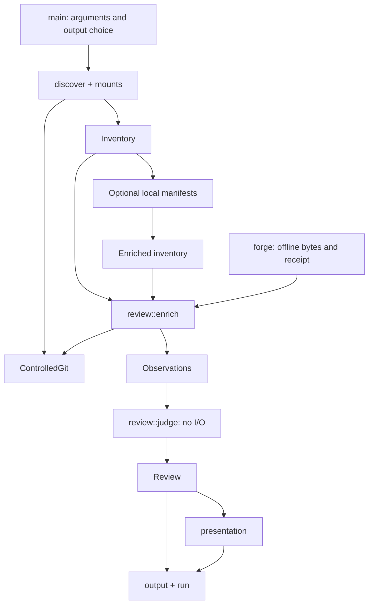

# Architecture

[Documentation index](README.md) · [Contributing](../CONTRIBUTING.md) · [Evidence contracts](contracts.md)

Worktree Sweep is one Rust crate with a CLI and library modules. There is no
daemon, model call, remote forge client or removal engine. The implementation
separates collection, judgement, presentation and publication.

## Data flow

The same supplied observations give the same judgement. Collecting again can
produce different observations, timestamps and digests as the filesystem changes.
Metadata concurrency preserves deterministic aggregation on a stable fixture;
it does not establish a snapshot.

## Module map

| Module | Responsibility |
| --- | --- |
| [main](../src/main.rs) | Parse the narrow CLI, apply scan-wide local budgets, select outputs and keep `apply` unavailable. |
| [model](../src/model.rs) | Versioned serializable contracts and byte-preserving identities. |
| [discover](../src/discover.rs) | Bounded traversal, marker discovery, deduplication, coverage and injectable filesystem provider. |
| [mounts](../src/mounts.rs) | Read macOS mount observations without silently filtering volume types. |
| [residency](../src/residency.rs) | Disable and verify dataless-file materialization for protected reads. |
| [git](../src/git.rs) | Controlled Git execution, family inventory and administrative cross-checks. |
| [local](../src/local.rs) | Descriptor-based resident-file observations, hashes, index parsing and per-worktree budgets. |
| [forge](../src/forge.rs) | Parse local exports, check receipts, retain positive facts and coverage gaps. |
| [review](../src/review.rs) | Collect verified object relationships, associate forge facts, then judge without I/O. |
| [presentation](../src/presentation.rs) | Escaped descriptions, detailed report and five-line summary. |
| [output](../src/output.rs) | Bounded artifact reads, canonical digests and exclusive publication outside inspected boundaries. |
| [run](../src/run.rs) | Publish one run directory and its artifact receipt. |

## Read and publication boundaries

Git uses an explicit executable, argument list and controlled environment.
Executable configuration such as hooks, filters and fsmonitor is neutralized;
implicit object downloads are denied. Output, input and execution time are
bounded, and exit status is checked before output can become evidence. A failure
cannot become a valid empty result.

The native materialization policy applies to the process, reading threads and
Git children. This also covers indirect Git reads through includes, alternates
and packs. It does not forbid all network activity through an already mounted
remote filesystem, and actual FileProvider/TCC behavior remains unverified.

Local collection opens directories and files through descriptors, records
identity and checks observed changes. Git calls for that collector select the
acquired worktree descriptor as their working directory. This avoids returning
to a substituted path; it does not exclude concurrent writers.

Publication refuses existing files, symlink ancestors and inspected locations.
For a saved review, boundaries include current registrations as well as those
from the input inventory. Each run owns a new directory. See
[native boundaries](native-boundaries.md) for the three private unsafe exceptions
and [run receipts](contracts.md#run-receipts) for the publication protocol.

## Verification design

Rust integration tests exercise real temporary Git repositories, parsers,
positive relationships and refusals. Python oracles independently compare
before/after state and inspect artifacts. Discovery providers inject roots,
mount changes and access failures without scanning the developer's machine.

The [exclusion experiments](../experiments/exclusion/) demonstrate failure modes
of proposed writer-exclusion techniques, including an already-open descriptor
outside the target cwd and a late detached commit. A passing counterexample test
means the proposed protection failed in that case. It does not open the apply gate.

Run instructions are in [CONTRIBUTING.md](../CONTRIBUTING.md). Observed results
and skipped cases live in the [implementation record](progress.md) and
[finishing ledger](finish-ledger.md).

## Future removal boundary

The [acceptance plan](plan.md) requires demonstrated writer exclusion before
durable backup and independent restoration. Only then can fixture removal be
implemented, followed by independent review and exact approval for real use.
The proposed `wt-sweep.apply-plan/1` is a future contract, not an emitted artifact.

The [decision index](decisions/README.md) records the failed mechanisms and next
proof obligations. The development harness cannot supply the missing authority.
