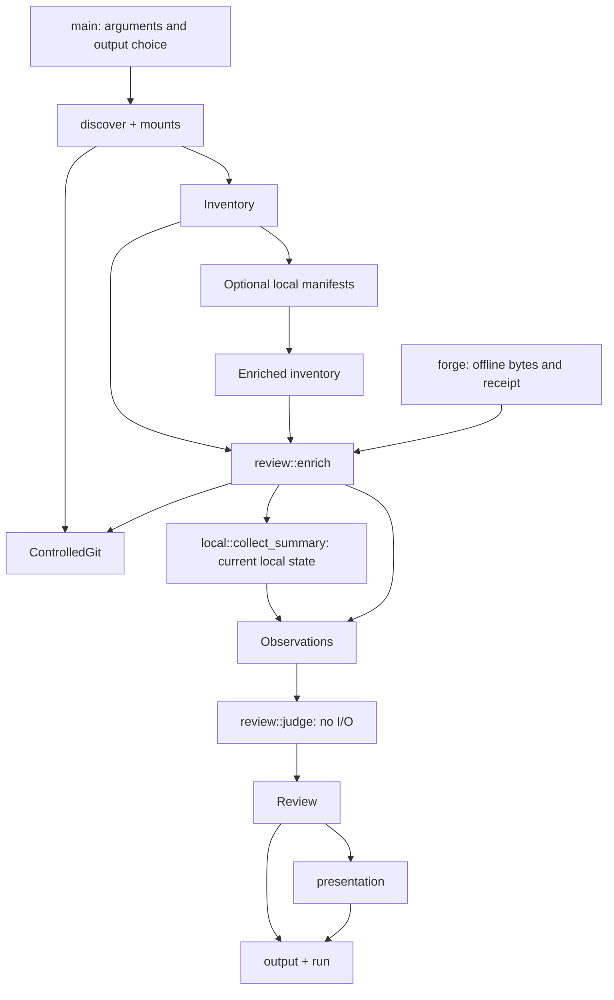

# Architecture

[Documentation index](README.md) · [Contributing](../CONTRIBUTING.md) · [Evidence contracts](contracts.md)

Worktree Sweep is one Rust crate with a CLI and library modules. There is no
daemon, model call, remote forge client or removal engine. The implementation
separates collection, judgement, presentation and publication.

## Data flow

`review` collects a fresh inventory and passes it through the same enrichment,
judgement and presentation path as `plan`. `scan` saves discovery separately;
`plan` accepts that saved inventory. Review publication keeps the full original
input and binds it through `inventory_sha256`, rather than compacting it before
judgement. A source exceeding the publication limit is refused with a narrower
scope required.

`review::judge` returns the same judgement for the same observations. A new scan
can produce different observations, timestamps and digests as the filesystem
changes. Parallel metadata reads aggregate deterministically on a stable
fixture, but a scan does not capture an atomic snapshot.

## Module map

| Module | Responsibility |
| --- | --- |
| [main](../src/main.rs) | Parse scoped scan/review and saved-input plan arguments, select outputs, expose command help and refuse `apply`. |
| [model](../src/model.rs) | Versioned serializable contracts and byte-preserving identities. |
| [discover](../src/discover.rs) | Bounded traversal, marker discovery, deduplication, coverage and injectable filesystem provider. |
| [mounts](../src/mounts.rs) | Read macOS mount observations without silently filtering volume types. |
| [residency](../src/residency.rs) | Disable and verify dataless-file materialization for protected reads. |
| [git](../src/git.rs) | Controlled Git execution, family inventory and administrative cross-checks. |
| [local](../src/local.rs) | Descriptor-based manifests plus a separate compact current-state collector, with independent index, traversal and output budgets. |
| [forge](../src/forge.rs) | Parse local exports, check receipts, retain positive facts and coverage gaps. |
| [review](../src/review.rs) | Collect current controls, graph facts, private history, verified integration and optional context; associate forge facts, then judge without I/O. |
| [view](../src/view.rs) | Select and group reviewed rows while retaining source totals, bindings and gaps. |
| [cancel](../src/cancel.rs) | Propagate interruption to bounded collection and publication. |
| [presentation](../src/presentation.rs) | Escaped descriptions, detailed report and five-line summary. |
| [output](../src/output.rs) | Bounded artifact reads, canonical digests and exclusive publication outside inspected boundaries. |
| [run](../src/run.rs) | Publish one run directory and its artifact receipt; review binds inventory, review and text together. |

## Read and publication boundaries

`ControlledGit` selects the executable, arguments and environment. It neutralizes
executable configuration such as hooks, filters and fsmonitor, denies implicit
object downloads, and limits input, output and execution time. It checks the
exit status before accepting output, so a failed command cannot supply an
apparently valid empty result.

The native materialization policy applies to the process, reading threads and
Git children. This also covers indirect Git reads through includes, alternates
and packs. It does not forbid all network activity through an already mounted
remote filesystem, and actual FileProvider/TCC behavior remains unverified.

Local collection opens directories and files through descriptors, records
identity and checks observed changes. Git calls for that collector select the
acquired worktree descriptor as their working directory. This avoids returning
to a substituted path; it does not exclude concurrent writers.

The output code refuses existing files, symlink ancestors and inspected locations.
Before saving a review, it checks current worktree registrations as well as those
from the input inventory. Each run creates a new directory. See
[native boundaries](native-boundaries.md) for the three private unsafe exceptions
and [run receipts](contracts.md#run-receipts) for the publication protocol.

## Verification design

Rust integration tests exercise real temporary Git repositories, parsers,
positive relationships and refusals. Python oracles independently compare
before/after state and inspect artifacts. Discovery providers inject roots,
mount changes and access failures without scanning the developer's machine.

The [exclusion experiments](../experiments/exclusion/) demonstrate failure modes
of proposed writer-exclusion techniques, including an already-open descriptor
outside the target cwd and a late detached commit. These tests pass when they
reproduce a failure of the proposed protection; their success does not satisfy E1.

Run instructions are in [CONTRIBUTING.md](../CONTRIBUTING.md). Observed results
and skipped cases live in the [implementation record](progress.md) and
[finishing ledger](finish-ledger.md).

## Future removal boundary

The [acceptance plan](plan.md) requires demonstrated writer exclusion before
durable backup and independent restoration. Only then can fixture removal be
implemented, followed by independent review and exact approval for real use.
The proposed `wt-sweep.apply-plan/1` is a future contract, not an emitted artifact.

The [decision index](decisions/README.md) records the failed mechanisms and the
evidence still needed. Development-harness checks do not verify writer exclusion,
backup or restoration.
