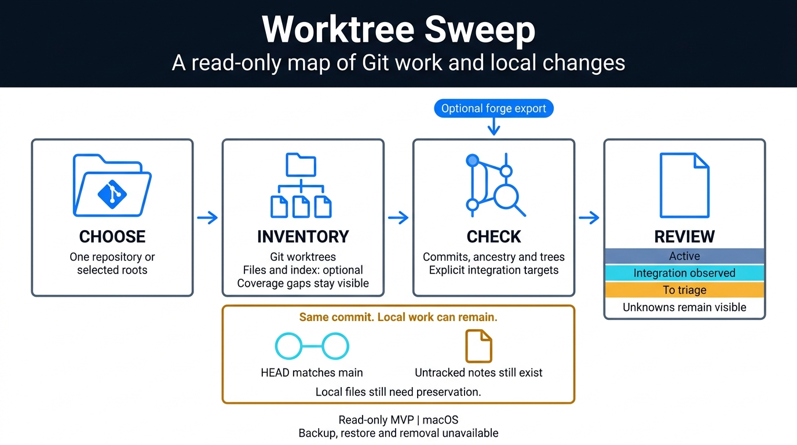

# README illustrations

[Documentation index](../README.md) · [Project overview](../../README.md)

## Current HTML report

The English and French READMEs use captures of the native HTML report in
[light](report-light.png) and [dark](report-dark.png) BoldGuy themes.
They show a disposable synthetic Git family, not private worktrees.
The report came from the current local generator on 2026-10-08; delivery of
this presentation update is tracked in #16.

The demo contains four worktrees: the main checkout, a clean linked worktree at
the target commit, an untracked note and a branch with unmerged work. The CLI
reports three `keep` and one `cleanup_candidate`. It still requires a usage
check; the report does not authorize removal.

The fixture builds on `HistoryFixture` in `tests/inventory_support.py`.
The command shape is `review --repo FIXTURE --target refs/heads/main --disk-usage --summary --html --run-dir OUTPUT`. The before/after filesystem manifest is
identical, HTML verdicts match JSON, and every published artifact matches its
receipt size and SHA-256. The screenshots are native Chromium captures, without
image generation or changes to the report contents. The [capture record](report-captures.json)
names the viewport, dimensions, binary/report hashes and image hashes. Overview
images show a 1440 × 800 viewport; detail images capture the full family section
(1136 × 1427). Both themes were inspected at native size. All four rows remain
in the source report; the overview screenshot only shows its summary.

Workflow and classification remain editable Mermaid diagrams in both READMEs.
Older SVG and Gemini images stay below as historical records; their earlier
classification labels do not describe the current triage policy.

## Historical Git integration illustration

The project README previously used this example to show why a Git integration
observation does not establish preservation of local files. The
[disposable demo](../getting-started.md#disposable-demo) creates both observations:
the worktree HEAD matches `refs/heads/main`, while `notes.txt` is untracked.
`scan --local` records its hash and metadata without copying its contents.

[Editable SVG](git-and-local-work.svg), 1600 × 944. It uses the dark navy panels,
monospace text and mint/amber accents of the Agent Router examples supplied in
the conversation. Text and shapes are authored directly in SVG, with no external
fonts, scripts, images or image-generation call. The SVG includes a title and
description; the README also provides descriptive alt text.

The text describes the demo and the [manifest contract](../contracts.md#inventory-and-local-manifests).
The lower banner states the current [preservation limits](../decisions/apply-readiness.md).
The SVG retains the historical `integration_observed` label. Current
`triage/1` instead retains a worktree with observed untracked work as `keep`.
It is archived here rather than used to describe the current interface.

Reviewed on 2026-10-05 at native size and at 860px README width. All 21 text
elements fit the canvas and their panels. Replaying the disposable demo
reproduced `identical_commit` against `refs/heads/main` and the `untracked`
35-byte note; its recorded SHA-256 matched the file on disk.

## Previous workflow infographic

Generated with Gemini 3 Pro Image and reviewed on 2026-10-05. The third response
was accepted and used in the project README before the SVG above replaced it.
The two earlier drafts remain recorded with their defects.

### Intent and source claims

Explain the read-only journey from explicit scope to inventory, Git relationship
checks and review. The separate example shows a HEAD matching an integration
branch while an untracked local note remains. This follows the
[disposable demo](../getting-started.md#disposable-demo).

The optional forge input is a captured export. Files and index are optional
inventory evidence. Unknowns remain visible, and backup, restore and removal
remain unavailable. The [CLI](../cli.md) and [evidence contracts](../contracts.md)
define these limits; the illustration does not replace them.

The visual references were the workflow graphic in
[yt-insights](https://github.com/FlorianBruniaux/youtube-video-insights) and the
terminal presentation in Agent Router, a private repository inspected locally.
The yt-insights reference was also inspected locally. Only the text brief was
sent to Gemini. The accepted render uses a navy header and white content area,
a cosmetic departure from the fully dark brief that preserves clear contrast.

### Editable sources and provenance

- [Accepted generation brief](worktree-sweep-workflow-v2.prompt.md): closed text
  inventory, layout, four directed edges and product boundaries.
- [Requested dark-theme brief](worktree-sweep-workflow-v3.prompt.md): AgentSec-style
  revision prepared on 2026-10-05 and not executed. The project README now uses
  native HTML captures; the historical image here remains the third response.
- [Original brief](worktree-sweep-workflow.prompt.md): retained for attempts 1–2.
- [Mermaid source](worktree-sweep-workflow.mmd): editable logical content and the
  separate local-preservation example.
- [Generation record](generation.json): model and CLI hash, prompt hashes, call
  authorization, native hashes, outcomes, metadata, QA and final image hash.
- [Delivered JPEG](worktree-sweep-workflow.jpg): 1376 × 768 pixels, byte-identical
  to the accepted native response. No crop, stretch, upscale or retouching.

### Observed review

The accepted image contains the 23 specified labels once, with no added textual
annotations. Classification labels sit below the empty report pictogram. The
four arrows have the specified direction and endpoints; the local example has
no connector to the workflow. All text was checked at native size and at 960px
README width. This is an assistant visual check, not an independent review or a
runtime validation of the product.

The request specified 16:9; the provider returned 1376 × 768. Native dimensions
are retained. A smaller copy was used only for the readability check.

### Attempt history and cost

| Attempt | Native output | Outcome | Estimated image output |
| --- | --- | --- | --- |
| 1 | [JPEG, 1376 × 768](history/workflow-attempt-01.jpg) | Rejected: added HEAD and commit annotations in the example icon. | $0.134 |
| 2 | [JPEG, 1376 × 768](history/workflow-attempt-02.jpg) | Rejected: duplicated classification labels inside the icon; Active missing from the main rows. | $0.134 |
| 3 | [JPEG, 1376 × 768](history/workflow-attempt-03.jpg) | Accepted after an explicitly authorized extra call and a revised standalone brief. | $0.134 |

Attempt 1 was renamed from .png to .jpg to match its actual MIME; its bytes were
unchanged. Both original briefs and all three native responses are preserved.
No paid attempt remains authorized.

Google lists standard image output at $0.134 for 1K/2K on the
[official pricing page](https://ai.google.dev/gemini-api/docs/pricing), checked on
2026-10-05. The latest response adds an estimated $0.134; cumulative image output
is estimated at $0.402. Input, text/thinking, grounding and taxes are excluded.
Actual billed usage is unknown because the CLI does not expose provider usage
metadata. Three final image responses are observed; that count is not a bill.
