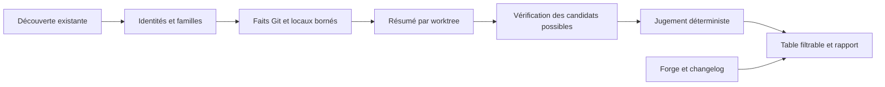

# Plan consolidé : tri des worktrees v2

[Critique architecture et plan](2026-10-05-worktree-triage-review.md) · [Proposition v1](2026-10-05-worktree-triage.md) · [Index documentaire](../../README.md)

Proposition du 05/10/2026, remplaçant la v1 pour l'ordre d'exécution. Code de
référence : `a551ae33d749c6ee947911a10926bb6decb46d26`. T01 à T09 sont implémentés
et validés localement ; leurs revues indépendantes sont conformes. Le
[registre final](../../finish-ledger.md#triage-t01-t09) consigne les tests et
les limites de l’essai réel. Les [contraintes initiales](../../plan.md) et la
[frontière de suppression](../../decisions/apply-readiness.md) restent applicables.

## Ce qui change

- B1 : prédicat de candidat explicite ; observations rapides, vérification de
  contenu, travail local et contexte ne se substituent plus les uns aux autres.
- M1 : premier correctif utilisable sans nouveau schéma ; chaque lot livre un
  comportement, ses tests verts et sa documentation minimale.
- M2 : cache limité à l'exécution et relance ciblée au départ. La reprise
  persistante devient X01 avec un déclencheur et un contrat propres.
- M3/M5 : résumé local compact, gros index et publication traités explicitement.
- M4/M6 : cibles par famille et matrice de charge indépendante du seul nombre
  de worktrees.

## Résultat utilisateur et périmètre

Lister les worktrees par dépôt ou répertoire, filtrer sur un dépôt ou un chemin,
puis lire pour chaque ligne : chemin complet, branche/HEAD, modifications locales,
stashes du dépôt, intégration observée, verdict, raisons et prochaine action.
Le détail donne les commits, PR/MR et changelog disponibles. Les noms et textes
sont affichés de façon échappée ; l'identité conserve les octets d'origine.

Le premier jalon est un dépôt ciblé. Le plan complet couvre ensuite les racines
et volumes accessibles du Mac. Tous les répertoires, y compris cachés, ignorés
et imbriqués, restent dans le périmètre demandé. Toute zone non visitée est une
lacune explicite. Aucun résultat ne prétend être un instantané de toute la machine.

Le parcours réutilise `scan` puis `plan`. T09 ajoute une entrée qui les enchaîne,
sans second moteur d'analyse. Aucun nom de commande future n'est une instruction
exécutable dans ce document. Les options et formats nouveaux sont des contrats
proposés, à tester et documenter dans le lot qui les introduit.

## Contrat de décision

Les domaines suivants portent chacun un état connu/inconnu, les faits positifs,
leurs sources, leur intervalle de collecte et les causes d'incomplétude :
identité/protection, histoire Git, contenu Git vérifié, travail local,
histoire propre au worktree, usage observé et contexte documentaire.
Une valeur inconnue n'est jamais encodée comme zéro.

| Verdict proposé | Condition exacte | Affichage obligatoire |
| --- | --- | --- |
| À conserver | Au moins un fait positif : checkout principal, verrou Git, opération Git en cours, usage observé, PR/MR ouverte associée au HEAD et au bon projet, modifications staged/unstaged/conflits, contenu non suivi ou ignoré présent, HEAD non intégré ou histoire propre non préservée | Raisons et actions pour préserver/examiner ce travail, même si d'autres domaines sont incomplets |
| Candidat au nettoyage | Toutes les conditions C1 à C5 ci-dessous, aucune raison positive de conserver | Preuves et intervalle, puis « usage à confirmer avant retrait ; aucune suppression autorisée par ce rapport » |
| À vérifier | Ni raison positive de conserver, ni ensemble complet C1 à C5 | Chaque condition manquante et la prochaine collecte ou décision nécessaire |

C1. Worktree lié présent, identité de famille/chemin/HEAD cohérente aux contrôles,
protection et opérations Git lues sans erreur. Un contrôle avant/après détecte
une dérive observée ; il ne garantit pas l'absence de toute modification entre les deux.

C2. HEAD identique à, ou ancêtre d'au moins une cible explicitement acceptée
pour cette famille, aux OID observés. La relation doit avoir franchi le niveau
de vérification d'objets requis par la politique existante. Une simple relation
rapide d'histoire, une égalité d'arbre, un squash suggéré ou une MR fusionnée ne
satisfait pas C2. Le rapport indique quelles cibles sont couvertes et celles
qui ne le sont pas. L'ascendance ne prouve pas l'absence de revert fonctionnel.

C3. Collecte complète des domaines de tri : contenu HEAD/index/fichiers,
types, modes Git et liens comparés ; aucun écart constaté, aucun contenu non
suivi ou ignoré, aucun de ces domaines non interprété. Type spécial,
sous-module non inspecté, index non pris en charge,
fichier non résident ou lecture refusée empêche C3. Pas d'exception par nom de
dossier. Si un contenu existe déjà, le verdict « à conserver » n'attend pas son
compte exact ni le hachage de tous ses descendants.

C4. Les racines d'histoire propres au worktree, dont HEAD, refs propres et
reflog HEAD, sont énumérées complètement. Chacune est atteignable depuis une
ref commune nommée qui sera conservée ou depuis une cible retenue, avec parcours
vérifié. Une racine dont l'atteignabilité est inconnue bloque C4. Une racine connue
non préservée impose « à conserver ». Une branche encore présente est une
observation de conservation, pas une sauvegarde durable ni une promesse contre
une suppression future. Les reflogs seuls et les HEAD d'autres worktrees ne
servent pas d'ancre stable à cette politique.

C5. Les domaines C1 à C4 proviennent de la revue courante, sans lacune bloquante
ni dérive observée. Les anciens manifestes de `scan --local` restent des
observations historiques : ils ne suffisent pas à qualifier les fichiers actuels.

L'usage non détecté ou non collecté reste **inconnu**, visible sur tout candidat
conditionnel. Il n'est jamais présenté comme inactivité démontrée. Une activité
positive impose la conservation. L'absence de forge, de changelog ou de message
de commit lisible ne bloque pas C1 à C5. Une PR ouverte reste un fait de forge à revoir,
pas une preuve d'utilisation du dossier. Elle reste toutefois une raison conservatrice
de garder le worktree lorsqu'elle est associée au bon projet et au HEAD courant,
conformément au contrat initial. Un stash partagé ne condamne pas tous
les worktrees et ne sert pas à certifier leur sauvegarde.

Les ACL, attributs étendus et objets inatteignables hors des racines examinées
restent hors de cette décision de tri. Leur absence n'est pas affirmée ; le
rapport les affiche parmi les limites de conservation. Ils restent à couvrir
dans le contrat de sauvegarde/retrait. Le candidat ne signifie donc jamais
« toutes les données sont préservées ». Cette limite ne doit pas être masquée
par une pastille verte ou un libellé « suppression sûre ».

## Architecture retenue



Conserver les modules existants. Le jugement ne fait aucune I/O ; la présentation
ne décide pas. Les contrôles de processus, si disponibles, alimentent les faits
de conservation. La forge et le changelog enrichissent le contexte et ne peuvent
pas créer un candidat.

Deux niveaux Git : une relation rapide dans le graphe de commits vérifiés pour
informer toutes les lignes, puis les vérifications approfondies sur les seuls
candidats possibles. Les résultats ont des champs et libellés distincts. Aucun
contrôle de la preuve actuelle n'est retiré silencieusement pour accélérer.

T01 garde les formats actuels. T02 introduit `wt-sweep.review/2` à son premier
consommateur, avec les domaines réellement collectés ; les domaines ultérieurs
ont un état explicite « non collecté ». `inventory/1` reste l'entrée de découverte.
Pas de migration générale d'inventaire prévue. Les anciens rapports restent des
archives v1, jamais converties en décisions actuelles. Toute commande de lecture
doit contrôler le schéma et refuser une version inconnue.

Le résumé v2 ne recopie pas les listes complètes de manifests locaux v1. Il lie
les sources par digest et porte compteurs, preuves, raisons et couverture. Les
limites de lecture/publication de 32 Mio restent explicites ; le détail doit être
borné en amont. Un détail omis devient une lacune, jamais un résultat vide.

## Phase 0 : vérifier les préconditions

- [x] Relever branche, HEAD et chemins modifiés ; préserver les modifications
  présentes. Lire les contrats actuels et les cas de conservation existants.
- [x] Préparer le test T01 sur un dépôt synthétique de quelques fichiers.
- [x] Confirmer que les scénarios C1 à C5 ont des résultats attendus écrits avant
  de raccorder le verdict, et que l'oracle ne réutilise pas le jugement produit.

Si T01 reproduit le défaut de priorité des cibles, corriger ce seul comportement.
Sinon, conserver le constat et isoler le premier goulot mesuré avant de choisir
un correctif. Ne pas commencer une migration de formats pour contourner un test
qui ne reproduit pas le défaut.

## Graphe de livraison

| Unité | Livre | Bloquée par | Validation observable |
| --- | --- | --- | --- |
| T01 | Les cibles demandées sont examinées avant les refs intermédiaires | Aucune | Une cible classée après plus de 128 refs produit sa preuve attendue, sans modifier les exigences de preuve |
| T02 | État local compact et lisible dans le rapport | T01 | Deux états distincts dans index/disque sont distingués ; contenu ignoré présent ne devient jamais zéro après interruption |
| T03 | Résultat d'histoire Git pour chaque ligne, progression et budgets équitables | T02 | Le dernier cas simple de la fixture reçoit son résultat malgré un premier cas coûteux ; preuve rapide et preuve approfondie restent distinctes |
| T04 | Stashes partagés et histoire propre à préserver | T02 | Deux worktrees partagent une seule liste de stashes ; le reflog exclusif d'un troisième reste une raison de conserver |
| T05 | Trois verdicts motivés de bout en bout | T03, T04 | Sur fixture connue : candidat, conservation et vérification tous présents ; un blob manquant interdit le candidat malgré l'ascendance |
| T06 | Cibles par dépôt, regroupements et filtres | T03 | Deux familles aux conventions différentes utilisent leurs propres cibles ; un filtre conserve les totaux et lacunes du scan |
| T07 | Commits, PR/MR et changelog dans le détail | T03 | Ajouter ou enlever un changelog ne transforme jamais une décision défavorable en candidat |
| T08 | Recherche machine observable et publication bornée | T06 | Ensemble attendu exact sur volumes injectés ; arrêt, refus d'accès et publication impossible ont des états distincts |
| T09 | Parcours complet, recette réelle et tutoriel | T05, T06, T07, T08 | La commande documentée produit le rapport attendu sur fixture ; le vrai dépôt reçoit des raisons vérifiables sans quota artificiel de candidats |

**Frontière initiale : T01.** Le chemin de dépendances de la décision est
T01 → T02 → T03/T04 → T05 → T09. Les branches consultation/contexte/découverte
convergent aussi vers T09. Aucun cycle. T03 et T04 sont logiquement séparables,
mais leurs fichiers communs exigent un intégrateur ; cela n'autorise pas une
délégation ou des éditions concurrentes par défaut.

## Phase 1 : un correctif minimal, T01

Fichiers : `src/review.rs`, `tests/test_review.py`, `CHANGELOG.md`.

- [x] Ajouter une fixture avec 140 refs intermédiaires et une cible explicite
  dont le nom se trie après elles. Vérifier l'OID et le rôle de la preuve attendue.
- [x] Observer l'échec, modifier seulement l'ordre des cibles, vérifier le succès
  et un cas où la cible est réellement inaccessible.
- [x] Garder les preuves v1, leur validation d'objets et le plafond global. Décrire
  la limite restante : ce correctif seul ne règle pas toute la saturation.

Livraison avec test vert. Aucun test obligatoire rouge n'est repoussé au lot
suivant. La doc et le changelog décrivent uniquement ce comportement livré.

Validation T01 observée le 05/10/2026 : deux tests comportementaux en échec avant
correction, puis positifs ; revue indépendante conforme sur spécification et
qualité. Suite finale : 92 tests Rust réussis, 2 ignorés ; 81 tests Python réussis,
5 ignorés. Formatage, Clippy et synchronisation du harnais passent. Les exclusions
concernent les données historiques privées, un point d'entrée enfant testé par
son parent et les noms non UTF-8 refusés par ce système de fichiers. Aucun scan
réel ni résultat de CI distante n'est revendiqué. Modifications locales sur
`codex/worktree-triage`, sans commit à cette étape.

## Phase 2 : construire le rapport par unités

Chaque unité suit test en échec → changement minimal → tests positifs et refus →
doc/contrat/changelog → revue. L'intégrateur possède `src/model.rs`, la CLI et
les métadonnées Cargo. Nommer les propriétaires avant toute délégation autorisée.

### T02 : état local actuel

Fichiers livrés : `src/local.rs`, `src/local/summary.rs`, `src/model.rs`,
`src/review.rs`, `src/presentation.rs`, `tests/local_summary.rs`,
`tests/test_local_summary.py`, `tests/review.rs` et documentation associée.

- [x] Comparer HEAD, index et fichiers en réutilisant les lectures contrôlées.
  Collecter maintenant l'état utile, sans promouvoir les anciens manifestes.
- [x] Séparer budget d'index, budget de parcours et budget de sortie. Traiter un
  index ordinaire de 25 001 entrées sans construire un détail publiable de même
  taille. Réserver une borne mémoire/octets ; au-delà, état incomplet explicite.
- [x] Couvrir staged, unstaged, suppressions, conflits, non suivis et ignorés.
  Un fait positif de travail suffit à expliquer la conservation avant la fin
  de la collecte. Un zéro exige la collecte complète de son domaine. Les
  répertoires structurels ne sont pas du contenu non suivi : un dépôt propre
  avec `src/main.rs` suivi doit rester propre ; un fichier ignoré ajouté dans
  `src` doit rester signalé même après interruption de son hachage.
- [x] Limiter d'abord l'interprétation aux formats ordinaires déjà supportés.
  Toute nouvelle commande Git est éprouvée sur fixture avec index, shared-index
  et métadonnées avant/après. Refuser sa promotion si elle écrit. X03 traite les
  formats supplémentaires lorsqu'ils bloquent un cas nécessaire.

Repli : conserver une raison locale précise pour le format ou la lecture refusée ;
continuer les autres worktrees. Aucun raccourci fondé seulement sur taille/mtime.

Validation T02 observée le 05/10/2026 : résumé actuel disponible dans
`wt-sweep.review/2`, avec comptes séparés, intervalles, empreintes et lacunes.
Les manifestes historiques restent dans l'inventaire ; le rapport les référence.
Les tests couvrent un index ordinaire de 25 001 entrées partageant de petits
blobs, les conflits, les fichiers ignorés, les formats refusés, les erreurs
d'accès et les lectures Git bloquées. Ce résultat ne mesure pas le passage à
l'échelle de nombreux objets distincts ni de nombreux worktrees ; c'est T03.

La revue indépendante a fait corriger la perte de positifs après interruption,
la confusion entre erreur de lecture et changement observé, la taille des
résumés de repli et la copie des manifestes. Un timeout Git nécessaire à
l'histoire arrête les lectures dépendantes de cette famille pour l'exécution ;
les autres familles continuent. Une erreur physique ou un timeout des règles
d'exclusion ne supprime pas les preuves Git indépendantes.

Revue finale conforme sur spécification et qualité. Vérifications : 124 tests
Rust réussis, 2 ignorés ; 105 tests Python réussis, 5 ignorés, dont les 24 scénarios
CLI également exécutés indépendamment sur un binaire figé. Les manifestes de
contrôle des fixtures restent identiques. Formatage, Clippy et synchronisation
du harnais passent ; 274 liens documentaires locaux vérifiés. Aucun scan réel,
commit, push ou résultat de CI distante n'est revendiqué. Le jugement reste
`local-evidence/1` ; les verdicts de triage arrivent en T05.

### T03 : histoire Git et équité

Fichiers : `src/review.rs`, `src/git.rs`, `src/model.rs`, `src/presentation.rs`,
`tests/review.rs`, `tests/test_review.py`, nouveau `tests/test_scale.py`.

- [x] Partager dans cette seule exécution les commits vérifiés, résolutions de
  cibles et résultats de parcours. Revalider les cibles avant publication.
- [x] Faire un tour borné par worktree avant l'approfondissement d'un seul cas.
  Les unités de travail sont lectures d'objets, octets et étapes de parcours ;
  les limites de temps restent un dernier arrêt, pas l'oracle du test d'équité.
- [x] Sortir du parcours devenu impossible après épuisement d'un budget ; ne plus
  lancer des résolutions qui ne peuvent produire aucune preuve. Afficher phase,
  nombre traité et cause d'arrêt sur stderr, sans polluer le JSON stdout.
- [x] Distinguer, pour chaque cible, absence d'ascendance complètement examinée
  et parcours incomplet. Tester un HEAD divergent face à toutes les cibles,
  une cible inaccessible et une seconde cible qui couvre effectivement ce HEAD.
  L'absence de preuve positive ne devient jamais une preuve de non-intégration.
- [x] Les observations d'histoire sans vérification de contenu ne remplissent
  jamais le champ des preuves approfondies. Ne pas appeler le résultat « sûr ».

Repli : résultat déjà observé conservé avec intervalle ; reste inconnu et relance
possible sur une famille ou un worktree choisi. Pas de cache disque dans ce lot.

Validation T03 observée le 05/10/2026 : les fixtures de 46 puis 100 worktrees
aux HEAD distincts reçoivent leurs résultats d'histoire, y compris avec ordre
inversé et premier cas coûteux. Graphe seul, preuve approfondie et inconnues
restent séparés. Les timeouts d'une famille arrêtent ses lectures dépendantes
dans toutes les phases, y compris les revalidations finales ; les autres familles
continuent. Un contrôle sauté ne retire pas l'interprétation déjà vérifiée de
l'index. Une dérive constatée invalide les faits courants et conserve les
observations antérieures comme telles.

Revue indépendante conforme après correction des compteurs et des timeouts.
Vérifications finales : 145 tests Rust réussis, 2 ignorés ; 121 tests Python
réussis, 5 ignorés. Ces tests Python incluent 7 contrôles préparatoires des
fixtures T04, sans validation du produit T04. Formatage, Clippy et synchronisation
du harnais passent. Le binaire figé porte le SHA-256
`c6ac6e6d1f471b3077a892fe8ef3d406f89b699adb45bd7de7245b0370a8b841`.
Aucun scan réel, commit, push ou résultat de CI distante n'est revendiqué.

### T04 : stashes et histoire propre

Fichiers : `src/git.rs`, `src/local.rs`, `src/model.rs`, `src/presentation.rs`,
`tests/local.rs`, `tests/test_enriched.py`.

- [x] Lire les stashes une fois par identité de dépôt commun, avec OID, base,
  date, message borné et liste de fichiers bornée. La branche du message est un
  indice, pas l'attribution d'un stash à un dossier. Un même remote ne fusionne
  pas deux clones distincts en une famille.
- [x] Énumérer les refs et reflogs propres nécessaires à C4, puis vérifier leur
  atteignabilité depuis les ancres communes retenues. Source absente, parcours
  borné ou incohérence reste inconnu. Ne créer aucune ref de récupération.
- [x] Tester reflog seul, HEAD détaché couvert/non couvert, stash partagé entre
  deux worktrees, deux clones du même remote et métadonnées devenues illisibles.

Repli : les stashes illisibles restent du contexte inconnu ; une histoire propre
non examinée bloque C4. Aucune application ou suppression de stash.

### T05 : décision et vérification approfondie

Fichiers : `src/review.rs`, `src/model.rs`, `src/presentation.rs`,
`tests/review.rs`, `tests/test_enriched.py`, `tests/cli.rs`.

- [x] Coder la table C1 à C5 dans un jugement pur. Priorité aux raisons positives
  de conserver, puis candidat si les conditions sont satisfaites, sinon vérifier.
- [x] Approfondir les candidats possibles avec les contrôles d'objets existants,
  les faits locaux de la revue courante et C4. L'arrêt ne retire pas les faits
  rapides ; il interdit seulement la promotion au verdict candidat.
- [x] Séparer inconnues bloquantes et contexte non collecté. Chaque candidat
  conserve la mention d'usage à confirmer et la date ; `apply` reste refusé.
- [x] Tester la matrice de décision, dont absence de forge/changelog, blob
  manquant, ignoré présent, conflit, dérive et preuve seulement par arbre identique.

Repli : aucun candidat émis si ses préconditions manquent ; les raisons précises
restent disponibles. Pas de commande destructive générée dans le rapport.

### T06 : plusieurs dépôts et filtres

Fichiers : `src/main.rs`, `src/model.rs`, `src/review.rs`, `src/presentation.rs`,
`tests/cli.rs`, `tests/model.rs`.

- [x] Conserver la cible explicite simple pour une seule famille. Pour plusieurs
  familles, proposer un fichier fourni explicitement associant identité du dépôt
  commun, chemin en octets et refs complètes. Vérifier l'identité au chargement ;
  absence ou doublon contradictoire ne sélectionne pas une cible par défaut.
- [x] Tester deux familles dont une vise `develop` et l'autre `main`, y compris
  lorsque les deux noms existent dans les deux familles. Afficher les OID retenus
  et distinguer ref locale et ref distante connue localement. Aucun fetch.
- [x] Appliquer les filtres après jugement : dépôt, préfixe par composants de
  chemin, branche, état local et verdict. Garder totaux et couverture de la source.
  Définir le tri sur les identités réversibles, pas sur le texte échappé.

Repli : famille sans cible toujours listée, avec intégration indéterminée. Aucun
filtre n'autorise une conclusion plus favorable.

### T07 : contexte explicatif borné

Fichiers : `src/git.rs`, `src/forge.rs`, `src/presentation.rs`,
`tests/forge.rs`, `tests/test_enriched.py`.

- [x] Montrer les commits non couverts par la cible, le résumé de fichiers et les
  imports forge actuels, avec hôte/projet/HEAD/date. Ne pas appeler une PR ouverte
  « processus actif ». Mentionner les limites des squash, cherry-picks et reverts.
- [x] Lire les changelogs suivis à une révision explicite, depuis des chemins
  reconnus à la racine ou fournis explicitement dans le dépôt. Ne pas suivre de
  lien vers un fichier extérieur. Borner extraits et résultats ; citer leur source.
- [x] Tester texte trompeur, absence de changelog, source trop grande, caractères
  de contrôle et redirection extérieure. Aucun de ces textes n'entre dans C2.

Repli : contexte absent ou partiel ; les autres preuves et verdicts restent
lisibles. Aucun appel réseau ou envoi de fichiers ajouté implicitement.

### T08 : découverte machine et publication

Fichiers : `src/discover.rs`, `src/mounts.rs`, `src/main.rs`, `src/output.rs`,
`src/run.rs`, `tests/discover.rs`, `tests/mounts.rs`, `tests/output.rs`, `tests/cli.rs`.

- [x] Réutiliser les modes dépôt/racines/volumes. La famille inclut ses worktrees
  enregistrés hors racine ; leur identité et la portée des lectures sont affichées.
  Tester `.git` fichier/dossier, bare, administration séparée, chemins cachés,
  alias, volumes absents et accès refusés avec des racines injectées.
- [x] Afficher progression et périmètre restant. Permettre une relance explicitement
  limitée à une famille/racine. Toute découverte incomplète reste incomplète,
  même si tous les worktrees déjà trouvés ont été examinés.
- [x] Budgéter le JSON réellement publié avant d'accumuler le détail. Garder une
  marge pour les métadonnées et erreurs ; supprimer d'abord le détail facultatif
  en le signalant. Si les lignes compactes dépassent encore la limite, publier un
  résultat partiel avec le périmètre non publié explicite, jamais tronquer du JSON.
- [x] Garder les vérifications de destination hors dépôts et sans liens. Si une
  famille déplacée/illisible empêche cette preuve, refuser l'écriture et expliquer
  le motif sur stderr. Ne pas prétendre qu'un rapport durable existe.
- [x] Tester disque plein, interruption et échec entre fichiers et reçu final.
  Un répertoire sans reçu final valide n'est pas une exécution terminée. Les
  sorties antérieures ne sont ni remplacées ni effacées automatiquement.

Repli : rapport partiel vérifiable si publication possible, sinon diagnostic
explicite et relance ciblée. Une progression seule n'est pas un checkpoint durable.

### T09 : parcours et recette

Fichiers : `src/main.rs`, `tests/cli.rs`, `tests/test_scale.py`, `README.md`,
`README.fr.md`, `docs/tutorial.fr.md`, `docs/cli.md`, `docs/finish-ledger.md`.

- [x] Enchaîner collecte et revue dans un parcours unique qui réutilise leurs
  fonctions, ajoute l'aide par commande et conserve les deux commandes existantes.
- [x] Vérifier la matrice ci-dessous et les checks du dépôt. Le nouvel exécutable
  sait expliquer les archives v1 comme anciennes ; il ne leur attribue pas C5.
- [x] Refaire ensuite l'essai du dépôt choisi avec sa cible confirmée, en lecture
  seule. Recompter les worktrees : 46 est le résultat historique, pas un attendu
  permanent. Produire le rapport hors du dépôt et des fixtures publiques.
- [x] Garder le scan réel de la machine comme exécution distincte, sur périmètre
  explicitement lancé. Les tests injectent racines et volumes ; aucun scan global
  réel n’a été exécuté dans cette recette. Accès refusés et volumes non visités
  restent des lacunes, sans promesse de couverture machine.
- [x] Documenter commandes prêtes à copier, filtres, cibles par dépôt, diagnostic
  d'arrêt, relance ciblée et prompt de revue. Actualiser le changelog à chaque lot.

Recette finale : 48 worktrees dans le dépôt choisi, 3 `keep`, 45 `verify`,
aucun candidat. Les budgets locaux et d’histoire empêchent encore une analyse
complète de ce gros dépôt. Les fixtures positives de candidats passent ; ce
résultat ne se transpose pas aux worktrees réels incomplets. Voir le
[registre de validation](../../finish-ledger.md#triage-t01-t09).

## Matrice d'acceptation

Les nombres ci-dessous définissent des fixtures proposées, pas des mesures déjà
réalisées. Les tests courants restent petits ; la combinaison lourde est séparée.

| Cas | Charge isolée | Attendu |
| --- | --- | --- |
| Priorité | 140 refs, quelques fichiers | Cible explicite examinée avant la borne des refs intermédiaires |
| Équité | 46 puis 100 worktrees petits, un cas coûteux en tête | Dernier cas simple traité ; décisions identiques à couverture équivalente et ordre différent |
| Index | Un worktree avec 25 001 entrées ordinaires | État local interprété dans le budget de résumé, sans dépendre du plafond du manifeste détaillé |
| Ignorés | Un gros dossier ignoré, fichier sentinelle et descendants cachés | Contenu présent signalé ; compte incomplet explicite ; aucun candidat issu d'une exclusion |
| Histoire | Plus de 512 commits dans une fixture dédiée | Parcours abouti ou limite explicite ; aucun faux négatif présenté comme preuve complète |
| Décision | Principal, intégré propre, dirty, inconnu, détaché, reflog exclusif | Les trois verdicts apparaissent aux lignes prévues par l'oracle |
| Sortie | Données juste sous puis au-dessus du budget de publication | JSON valide et lisible, détail omis déclaré ou refus explicite ; jamais succès silencieux sans rapport |
| Lecture seule | Témoins hooks/filtres, index/shared-index, fichiers et sentinelle extérieure | Aucun témoin exécuté ni changement attribuable au produit dans le manifeste indépendant |
| Reprise d'analyse | Nouvelle exécution après mutation locale à taille/mtime identiques | Aucune promotion du résultat ancien en état actuel |

Mesurer par phase lectures d'objets, octets, sous-processus et durée observée.
Les tests d'équité utilisent des budgets injectés, sans seuil fragile dépendant
de la vitesse de la machine. Aucun « nombre minimal de candidats » n'est imposé
au vrai dépôt. En revanche, la fixture positive doit produire un candidat.

À chaque lot, checks pertinents puis checks requis du dépôt avant livraison :

```sh
cargo fmt --all -- --check
cargo clippy --all-targets --locked --offline -- -D warnings
cargo test --locked --offline
python3 -B -m unittest discover -s tests -p 'test_*.py' -v
python3 -B scripts/sync-ai.py --check
```

Utiliser `rtk` ou `rtk proxy` selon les instructions locales. Exécuter ces tests
ne valide pas un scan réel ni une suppression.

## Extensions conditionnelles

| Unité | Déclencheur mesurable | Dépendances | Contrat et validation |
| --- | --- | --- | --- |
| X01, reprise persistante | Après T08, une racine demandée ne peut pas être achevée dans le budget choisi ; une relance ciblée recommence du travail déjà mesuré | T08 | Résultats immuables datés, version de politique, identité du périmètre, unités restantes et reçu de publication. Un sous-arbre terminé reste une observation passée. Revoir en direct C1 à C5 pour tout candidat ; invalider après remplacement, altération ou schéma inconnu. Tester apparition d'un dépôt dans une zone déjà visitée et interruption à chaque transition. |
| X02, lectures Git groupées | Sur la fixture 100 worktrees de T03, le budget temps est atteint alors que les budgets objets/octets restent disponibles et que les sous-processus représentent plus de la moitié du temps mesuré | T03 | Protocole borné, réponses liées à chaque demande, arrêt/récolte des enfants, mêmes vérifications d'OID. Comparer résultat et nombre de processus à l'exécuteur actuel. |
| X03, autre format d'index | T02 ou l'essai réel révèle un index valide non supporté qui empêche le tri d'un worktree du périmètre | T02 | Une unité par format ; oracle indépendant avant/après, staged/unstaged corrects et absence de mutation. Si le chemin Git écrit, conserver le refus jusqu'à une lecture sûre démontrée. |

Ces extensions ne sont pas nécessaires pour démarrer T01. Si leur déclencheur
est rencontré sur un scénario d'acceptation requis, elles deviennent des
dépendances de clôture de ce scénario ; ne pas déclarer le périmètre terminé
en les laissant simplement dans une liste future.

## Hors périmètre et retour arrière

Pas de suppression automatique, branche effacée, stash appliqué, fetch, prune,
gc, hooks installés, TUI, daemon ou index central de machine dans ces unités.
Les signaux d'usage ne démontrent pas E1. Le moteur de sauvegarde/restauration et
`apply` gardent leur chantier séparé ; aucune nouvelle permission système n'est
requise pour rédiger ou exécuter les tests de ce plan.

Un commit par comportement livrable. Pour revenir en arrière : arrêter les
exécutions de cette version, revenir sur le commit concerné dans le checkout de
développement après contrôle des changements concurrents, puis reconstruire.
Ne pas écraser un fichier modifié depuis ce commit ; résoudre le conflit avant
de poursuivre. Les anciens rapports restent archivés hors des dépôts inspectés.
La preuve du retour est le passage du scénario témoin sur la version restaurée
et l'absence de modification des fixtures inspectées. Un ancien binaire refuse
un nouveau format qu'il ne comprend pas ; aucune migration inverse de données
utilisateur n'est nécessaire.

## Critère de clôture

- [x] T01 à T09 satisfont leurs validations, ainsi que toute extension déclenchée
  par un scénario requis ; chaque unité est livrée avec tests verts.
- [x] Chaque worktree découvert a chemin, branche/HEAD, faits locaux, intégration,
  verdict et raisons ; une information inaccessible reste explicitement inconnue.
- [x] Le scan par dépôt et la découverte multi-racines retrouvent l'ensemble
  exact attendu sur fixtures. Les filtres n'altèrent ni preuve ni couverture.
- [x] Le rapport réel permet de distinguer travail à préserver, candidats
  conditionnels et vérifications manquantes. Les limites de couverture réelles
  sont publiées, sans transposer la complétude des fixtures à toute la machine.
- [x] `apply` reste indisponible ; le rapport n'annonce aucune conservation
  complète ou possibilité de retrait que ses preuves n'établissent pas.
