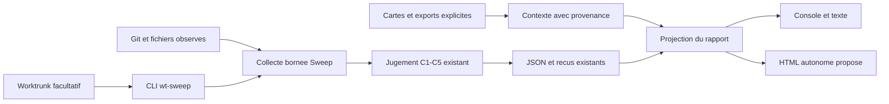

# Douze outils de worktrees : idées à reprendre dans Sweep

[Index documentaire](README.md) · [Recherche de projets](worktree-ecosystem-2026-10-07.md) · [Feuille de route](roadmap.md)

Analyse du code du 07/10/2026. Les 12 repos du comparatif précédent ont été
clonés sous `~/Sites/divers-tests/wt-sweep-comparison-20261007/`, dans des clones
neufs à profondeur 1, sans sous-modules ni installation. Les clones préexistants
de `~/Sites/divers-tests` sont restés intacts.

## Décision proposée

Conserver Sweep comme moteur d'inventaire et de revue, puis lui ajouter une
restitution HTML et des raccordements limités. La lecture des concurrents
justifie des emprunts précis, pas encore le remplacement du moteur. Aucun
contrat de conservation équivalent n'a été validé par exécution dans cet audit.

Les priorités utiles sont le tableau par projet, les raisons lisibles par
worktree, la mesure du délai avant le premier résultat utile, l'import passif
de provenance et l'entrée facultative `wt sweep` via Worktrunk. Un registre
propriétaire, un daemon, un terminal intégré ou une application desktop ne sont
pas nécessaires pour livrer ces améliorations.

## Ce qui a été analysé

Trois sous-agents spécialisés ont travaillé en parallèle : architecture backend
sur Holt, AgentRinse, Stalewood et gh-reaper ; Rust sur Worktrunk, Workroot et
le mécanisme APFS ; architecture système sur kwt, gwq et Git Worktree Runner.
L'intégrateur a examiné Worktree Manager, Superset et leur adéquation avec Sweep.
Les sous-agents ont conservé les réglages du modèle parent.

| Groupe | Lecture détaillée |
| --- | --- |
| Audit et récupération | [Analyse backend](research/worktree-source-2026-10-07/backend.md) |
| Rust, Git, performance et APFS | [Analyse Rust](research/worktree-source-2026-10-07/rust.md) |
| Registres, sessions, hooks et CLI | [Analyse système](research/worktree-source-2026-10-07/systems.md) |
| Interfaces et orchestration | [Analyse des interfaces](research/worktree-source-2026-10-07/interfaces.md) |

Les analyses relient fonctions, mécanismes, fichiers et tests présents. Les
commandes des produits, leurs suites de tests et leurs interfaces n'ont pas
été lancées. Deux captures versionnées ont été inspectées pour les interfaces ;
elles ne prouvent pas le rendu de la tête actuelle. Aucun classement de
performance ne découle de cette lecture. Les recommandations sont celles de
l'intégrateur, pas une approbation indépendante d'une implémentation livrée.

## Comparatif des fonctionnalités et de l'implémentation

| Projet | Mécanisme examiné dans le code | Ce qui mérite d'être repris | Limite pour Sweep |
| --- | --- | --- | --- |
| **Holt** | Analyse inter-worktrees, preuves de conservation, récupération et rendu SVG/HTML autonome avec filtres et détail. | Un graphe ciblé peut expliquer quel worktree ou quelle référence conserve du travail ; bons exemples de lecture progressive des preuves. | FSL hors `src/team`, licence commerciale dans `src/team` : vérifier le périmètre avant toute reprise de code. La récupération locale ne démontre pas notre sauvegarde autonome ni E1. |
| **AgentRinse** | Adaptateurs, plan lié à l'état, machine à états de récupération et renommage de quarantaine sans écrasement. | Journal d'étapes et résultats partiels explicites pour un futur protocole de récupération. | Une référence distante locale couvrant HEAD n'est pas la preuve d'intégration dans une cible choisie. Quarantaine et sauvegarde ont des objectifs différents. |
| **Stalewood** | Inventaire Go, base déduite avec provenance, classification, taille et JSON par repo. | Afficher l'origine d'une cible suggérée et les motifs de triage, sans la choisir à la place de l'utilisateur. | Le chemin d'erreur de lecture locale peut produire un état propre ; le retrait s'appuie sur un verdict précédemment collecté. Ne pas reprendre cette politique. |
| **gh-reaper** | Script shell de découverte, état Git, taille, processus et retrait. | Présentation synthétique des raisons et coût disque avant action. | Exclusions du parcours et des changements locaux, puis possibilité de force : son périmètre de propreté diffère du nôtre. |
| **Worktrunk** | CLI Rust extensible, collecte concurrente, présentation progressive, hooks et cycle de vie. | Tester l'exécutable externe `wt-sweep` invoqué par `wt sweep` ; mesurer et améliorer le premier résultat utile. | Les critères tree/merge-tree/patch-id ne remplacent pas C2. Les caches persistants ne doivent pas certifier l'état courant. |
| **kwt** | Registre, générations de worktrees, daemon et sessions ; opérations coordonnées. | Importer une génération et une provenance comme contexte ; distinguer nouveau worktree et chemin réutilisé. | Lister peut écrire une génération dans le dossier Git. Verrou coopératif et session connue ne prouvent pas l'absence d'autres processus d’écriture. |
| **gwq** | CLI Go, découverte dans une arborescence de base, sélection interactive, statuts et sessions tmux. | Sélection et sorties structurées ; raccourcis pour choisir un worktree déjà inventorié. | « Global » porte sur ses conventions de rangement. Ce n'est pas une couverture de tous les volumes. |
| **Workroot** | CLI Rust orientée cibles, découverte, statut, exécution et prune interactif. | Provenance des cibles et noms pratiques à traduire en chemins exacts pour la CLI. | PR fusionnée et patch-id servent à sa politique de nettoyage, pas aux preuves de Sweep. |
| **Git Worktree Runner** | Modules Bash de création, copies/préparation, éditeur/agent et nettoyage PR/MR. | Déléguer la préparation d'un environnement à un gestionnaire existant si elle devient un besoin. | Son `clean --dry-run` n'est pas sans mutation : prune et fetch sont possibles dans les chemins lus. |
| **Worktree Manager** | Tauri/React, backend Rust/git2, workspace multi-projets, PTY, cartes et MCP par niveau. | Chemin copiable, faits Git distincts, navigation et détails repliables. | L'archive masque la ligne et ferme ses PTY, sans sauvegarder les fichiers. Des erreurs Git peuvent rester masquées par des valeurs par défaut. |
| **Superset** | Electron/React, service hôte, SQLite/Drizzle, filtres, liste/board et suivi des opérations interrompues. | Tableau filtrable, groupes repliables, distinction entre aucune donnée, collecte en attente et zéro résultat filtré. | Statut de workflow et PR fusionnée ne sont pas verdicts de nettoyage. Licence racine Elastic-2.0, pas une reprise permissive présumée. |
| **claude-cow-worktree** | Hook Python utilisant `clonefile`, copie de l'index puis remise en état Git. | Référence pour expérimenter séparément la création APFS et expliquer le coût des copies. | Le clone CoW dépend des volumes source/staging ; un transfert inter-volume peut perdre le partage des blocs. Aucun calcul d'espace récupérable ni sauvegarde autonome n'en découle. |

Les anomalies citées sont des constats de chemins de code, non des incidents
reproduits. Les références précises et les limites de chaque lecture figurent
dans les quatre analyses liées ci-dessus.

## Les écarts à développer, sans refaire l'existant

Sweep possède déjà les verdicts déterministes, les filtres, le regroupement,
les reçus et digests, les budgets, les lectures Git groupées, des caches limités
au run et à la famille, la progression console et les mesures disque. Ces
éléments ne sont pas à réinventer à partir des concurrents.

| Réf. | Proposition | Source d'inspiration | Critère d'acceptation et coût relatif |
| --- | --- | --- | --- |
| D1 | **HTML autonome par projet** : tableau avec chemin, branche, verdict, raison, taille, lacunes ; recherche, tri et détails repliables. | Superset, Worktree Manager, Holt. | Scope moyen. Mêmes lignes/verdicts que le JSON, totaux source et filtrés séparés, aucune ressource réseau, caractères hostiles échappés, mesures partielles visibles, navigation clavier et rendu sans JavaScript. Le [plan HTML](html-report-plan.md) décrit le raccordement. |
| D2 | **Progression par résultat utile** et mesure du premier fait affiché, distincte du temps total. | Worktrunk. | Scope moyen. Mesurer séparément PTY et stdout pipé, sur la même fixture ; aucun verdict définitif avant ses vérifications finales, JSON inchangé, ordre stable à données fixes. Un squelette de tableau ne compte pas comme un résultat analysé. |
| D3 | **Entrée facultative `wt sweep`** avec Worktrunk, CLI indépendante conservée. | Dispatch d'exécutable externe Worktrunk. | Petit spike. Vérifier arguments, cwd, exit code, stdout/stderr et collisions de noms sur fixture. Aucun hook installé et aucune écriture Git supplémentaire. Ce n'est pas une intégration déjà testée. |
| D4 | **Provenance importée passivement** : carte `.worktree.json`, génération, session déclarée et dates de capture. | kwt et registre Aristote. | Scope moyen. Carte absente, périmée, malformée ou contradictoire sans changement de C1-C5 ; changement de génération/provenance détecté lorsqu’il est documenté ; réattribution non démontrable conservée inconnue. Ne pas invoquer une commande externe supposée « list » sans vérifier ses effets. |
| D5 | **Comparer les récupérations avant de construire la nôtre**. | Holt, AgentRinse, Superset pour le suivi d'interruption. | Scope élevé et conditionnel. Fixtures avec ignorés, index distinct, stash/reflog, processus d’écriture concurrent et arrêt à chaque étape ; oracle indépendant, puis restauration sans repo source. E1/U5-U7 restent requis. |
| D6 | **Séparer la création APFS des mesures de conservation**. | claude-cow-worktree. | Expérience bornée, hors collecte courante. Vérifier clone effectif ou copie classique, isolation des écritures, volumes source/staging/destination, ignorés, filtres/index et conservation de la source. Ne promettre aucun gain disque à partir de `st_blocks` seul. |

D1 répond directement au besoin de lire les résultats. D3 peut être vérifié
indépendamment. D2 doit suivre une mesure, pas une augmentation arbitraire des
workers. D4 répond au besoin de savoir d'où vient un worktree, sans créer un
nouveau registre obligatoire. D5 et D6 sont des comparaisons séparées ; elles
ne bloquent pas le rapport de lecture.

## Architecture proposée

Le schéma décrit une proposition, pas des modules nouvellement implémentés.

Le contexte importé n'entre pas dans le jugement. Le rendu ne relance pas Git,
ne transforme pas un badge « merged » en candidat et ne lance pas de commande
de nettoyage. Un graphe pourra compléter la fiche d'un worktree si des relations
sourcées sont disponibles ; il n'est pas requis pour comprendre le tableau.

## Vérifications à effectuer avant une adoption

1. Comparer Sweep, Holt et AgentRinse sur les mêmes fixtures. Inclure un cas
   positif propre et intégré, puis index/disque divergents, ignorés, stash et
   historique privé. Comparer les contrats, pas seulement le nombre de candidats.
2. Mesurer premier fait utile, durée complète et couverture sur 50 puis 100
   worktrees synthétiques constants. Séparer lecture seule et fonctionnalités
   qui écrivent leur propre registre/cache ; consigner environnement et cache OS.
3. Essayer `wt sweep` sur un repo de test temporaire et importer des métadonnées déjà
   capturées. Vérifier que les deux chemins conservent les artefacts et refus de
   Sweep. Ne pas installer les hooks des concurrents pour cet essai.
4. Exécuter les scénarios de récupération indépendamment du développement HTML,
   avec exclusions des écritures externes traitées comme un sujet non résolu.

Ces essais ne sont pas exécutés dans cette analyse. Aucun concurrent n'a été
branché à un repo personnel, aucun worktree n'a été retiré, et aucun code de
concurrent n'a été intégré à Sweep. La lecture de licences dans les fichiers
sources n'est pas une validation juridique de compatibilité.

## Corrections par rapport à la recherche initiale

La lecture du code corrige trois raccourcis du premier comparatif : gwq possède
bien un registre de métadonnées, même si sa découverte globale suit son
répertoire de base ; Holt distribue aussi un périmètre `src/team` sous licence
commerciale distincte ; Superset déclare Elastic-2.0 à la racine. La voie kwt
`list` ne doit plus être envisagée comme une source passive sans examen de ses
écritures. Les idées retenues sont documentées sans copier de code produit.

## Versions examinées

Les SHA complets, chemins locaux, origines et états initiaux sont conservés dans
le [manifeste de clonage](research/worktree-source-2026-10-07/clones.json).
La profondeur 1 suffit à la lecture de ces versions, pas à un audit de leur
historique. Les licences ci-dessous viennent des fichiers des clones.

| Repo | Commit examiné | Licence du périmètre lu |
| --- | --- | --- |
| [Raed2180416/holt](https://github.com/Raed2180416/holt) | [`b99e098e214f4e84388ffa9d6fa6b675f951732a`](https://github.com/Raed2180416/holt/tree/b99e098e214f4e84388ffa9d6fa6b675f951732a) | [FSL-1.1-MIT hors src/team ; licence commerciale pour src/team](https://github.com/Raed2180416/holt/blob/b99e098e214f4e84388ffa9d6fa6b675f951732a/LICENSE-NOTICE.md) |
| [vincentkoc/agentrinse](https://github.com/vincentkoc/agentrinse) | [`6d5e047e00ef0193f6b75b952060a80ea310b1a4`](https://github.com/vincentkoc/agentrinse/tree/6d5e047e00ef0193f6b75b952060a80ea310b1a4) | [MIT](https://github.com/vincentkoc/agentrinse/blob/6d5e047e00ef0193f6b75b952060a80ea310b1a4/LICENSE) |
| [retif/stalewood](https://github.com/retif/stalewood) | [`1a9a61742efd45c7f9ceaf70a1304c34bbd16169`](https://github.com/retif/stalewood/tree/1a9a61742efd45c7f9ceaf70a1304c34bbd16169) | [MIT](https://github.com/retif/stalewood/blob/1a9a61742efd45c7f9ceaf70a1304c34bbd16169/LICENSE) |
| [ai-ecoverse/gh-reaper](https://github.com/ai-ecoverse/gh-reaper) | [`4dc9326eb10c8b03b8f6e23653f4dc02564c672a`](https://github.com/ai-ecoverse/gh-reaper/tree/4dc9326eb10c8b03b8f6e23653f4dc02564c672a) | [Apache-2.0](https://github.com/ai-ecoverse/gh-reaper/blob/4dc9326eb10c8b03b8f6e23653f4dc02564c672a/LICENSE) |
| [max-sixty/worktrunk](https://github.com/max-sixty/worktrunk) | [`e4a25d6e37cc7bfa6d133ba625359c58fd3cda08`](https://github.com/max-sixty/worktrunk/tree/e4a25d6e37cc7bfa6d133ba625359c58fd3cda08) | [MIT OR Apache-2.0](https://github.com/max-sixty/worktrunk/blob/e4a25d6e37cc7bfa6d133ba625359c58fd3cda08/LICENSE) |
| [kenn-io/kwt](https://github.com/kenn-io/kwt) | [`fccb0f5aac82f21e3a2d379418e12ffb8a11dbe6`](https://github.com/kenn-io/kwt/tree/fccb0f5aac82f21e3a2d379418e12ffb8a11dbe6) | [Apache-2.0](https://github.com/kenn-io/kwt/blob/fccb0f5aac82f21e3a2d379418e12ffb8a11dbe6/LICENSE) |
| [d-kuro/gwq](https://github.com/d-kuro/gwq) | [`ec0a9f3d6aef475c7c6ff7323f2038a372284ccd`](https://github.com/d-kuro/gwq/tree/ec0a9f3d6aef475c7c6ff7323f2038a372284ccd) | [Apache-2.0](https://github.com/d-kuro/gwq/blob/ec0a9f3d6aef475c7c6ff7323f2038a372284ccd/LICENSE) |
| [fridiculous/workroot](https://github.com/fridiculous/workroot) | [`3f25c89cdc6e77fbd9d490d7ec905ef73c13c0f8`](https://github.com/fridiculous/workroot/tree/3f25c89cdc6e77fbd9d490d7ec905ef73c13c0f8) | [MIT](https://github.com/fridiculous/workroot/blob/3f25c89cdc6e77fbd9d490d7ec905ef73c13c0f8/LICENSE) |
| [coderabbitai/git-worktree-runner](https://github.com/coderabbitai/git-worktree-runner) | [`d576398fc0642dc91cc248f63635e4dea283d416`](https://github.com/coderabbitai/git-worktree-runner/tree/d576398fc0642dc91cc248f63635e4dea283d416) | [Apache-2.0](https://github.com/coderabbitai/git-worktree-runner/blob/d576398fc0642dc91cc248f63635e4dea283d416/LICENSE.txt) |
| [guoyongchang/worktree-manager](https://github.com/guoyongchang/worktree-manager) | [`c7eeb3e08e97c957ffa1d618a40c39dd86325971`](https://github.com/guoyongchang/worktree-manager/tree/c7eeb3e08e97c957ffa1d618a40c39dd86325971) | [MIT](https://github.com/guoyongchang/worktree-manager/blob/c7eeb3e08e97c957ffa1d618a40c39dd86325971/LICENSE) |
| [superset-sh/superset](https://github.com/superset-sh/superset) | [`9a50076c324b3d2575762e5bdcba6838061c8be5`](https://github.com/superset-sh/superset/tree/9a50076c324b3d2575762e5bdcba6838061c8be5) | [Elastic-2.0 (racine)](https://github.com/superset-sh/superset/blob/9a50076c324b3d2575762e5bdcba6838061c8be5/LICENSE.md) |
| [palmin/claude-cow-worktree](https://github.com/palmin/claude-cow-worktree) | [`68c5957bad4bb24c2d46378dd3323b80edcca60a`](https://github.com/palmin/claude-cow-worktree/tree/68c5957bad4bb24c2d46378dd3323b80edcca60a) | [MIT](https://github.com/palmin/claude-cow-worktree/blob/68c5957bad4bb24c2d46378dd3323b80edcca60a/LICENSE) |

## Livraison de cette analyse

Ajouts : ce comparatif, quatre analyses spécialisées et le manifeste des clones.
L'index documentaire, les références, la recherche initiale, la roadmap et le
changelog pointent vers cette lecture du code. Les modifications produit déjà
présentes dans le worktree ont été conservées. Aucun commit ou push effectué
pour cette analyse.
